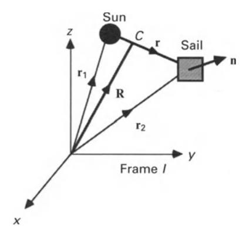
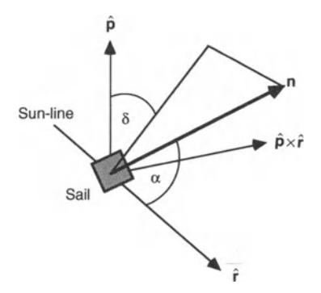
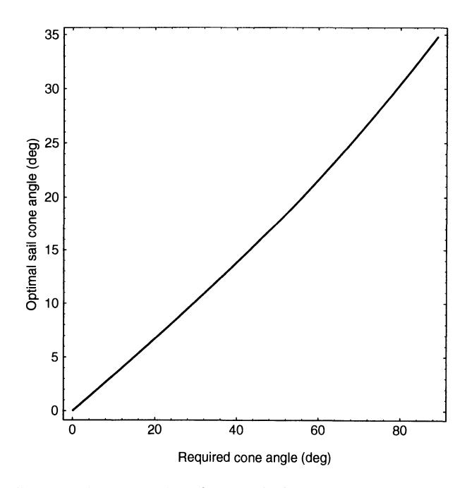
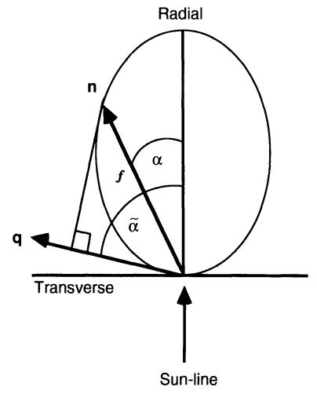
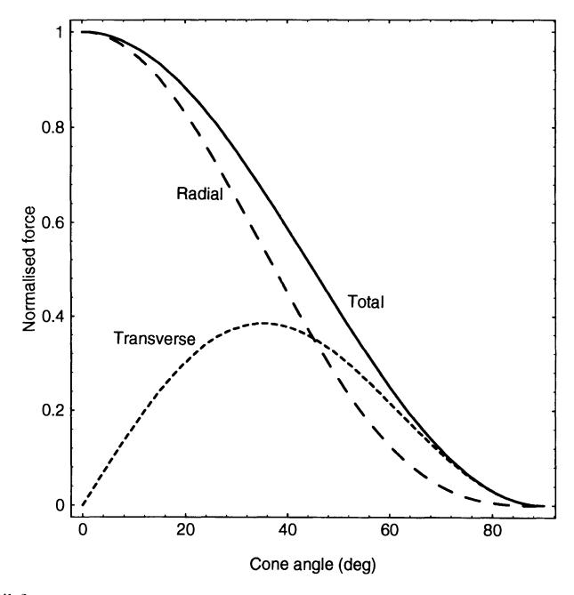
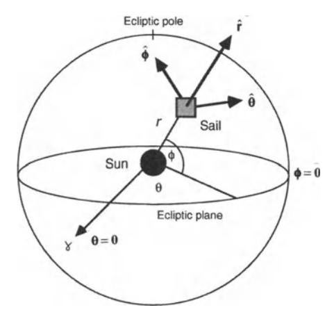
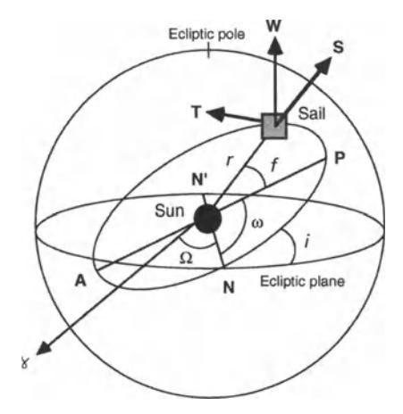

Following the derivation of the solar sail equations of motion, solutions are obtained for Sun-centred conic section orbits. These orbits are classified and simple elliptical transfer orbits are considered. Logarithmic spiral trajectories are then investigated as a potential form of interplanetary trajectory. Although it will be found that these trajectories are not particularly practical, they do provide valuable insight into solar sail dynamics. The Lagrange variational equations are then used to explore locally optimal solar sail trajectories where the sail attitude is chosen to maximise the rate of change of some particular orbital element or combination of elements. Although these trajectories are not globally optimal, they provide simple, suboptimal (although in some cases near optimal) orbit manoeuvring schemes. The calculation of true minimum time trajectories is also outlined using optimal control theory.

Following the discussion of Sun-centred orbits, planet-centred orbits are then considered. Various orbit-raising schemes are investigated using simple sail-steering laws. In particular, a locally optimal steering law is derived which maximises the instantaneous rate of increase of orbit energy. These laws are then compared and their relative merits discussed. It is also shown that for an inertially fixed solar sail attitude, the equations of motion have a closed form solution obtained using the Hamilton-Jacobi method. Lastly, minimum time planet-centred escape trajectories are discussed, again using optimal control theory. However, it will be found that for planetary escape, locally optimal steering laws provide excellent performance without the complexity of numerically generated optimal laws.

# **4.2 EQUA TIONS OF MOTION**

# **4.2.1 Vector equation of motion**

The equations of motion for a solar sail in a Sun-centred orbit may be obtained by considering the Sun (mass *M)* and solar sail (mass *m)* in an inertial frame of reference *I,* as shown in Fig. 4.1. In this frame of reference the centre-of-mass of the Sun-sail system C is located at position R, defined by

$$\mathbf{R}\frac{M\mathbf{r}_1 + m\mathbf{r}_2}{M + m} \tag{4.1}$$

Using Eq. (2.24) from section 2.3.3, the equation of motion of the Sun and a perfectly reflecting solar sail in the inertial frame *I* are given by

$$M\frac{\mathrm{d}^2\mathbf{r}_1}{\mathrm{d}t^2} = \frac{GMm}{r^2}\hat{\mathbf{r}} \tag{4.2a}$$

$$m\frac{\mathrm{d}^2\mathbf{r}_2}{\mathrm{d}t^2} = -\frac{GMm}{r^2}\hat{\mathbf{r}} + \beta \frac{GMm}{r^2}(\hat{\mathbf{r}} \cdot \mathbf{n})^2\mathbf{n}$$
 (4.2b)

where r = r2 - rl and *i* is the unit vector directed along the Sun-sail line. Subtracting Eq. (4.2b) and Eq. (4.2a) and using the definition of centre-of-mass from Eq. (4.1),

Fig. 4.1. Inertial frame of reference *J* with centre-of-mass *C.* 

the acceleration of the centre-of-mass of the system C is obtained as

$$\frac{\mathrm{d}^2 \mathbf{R}}{\mathrm{d}t^2} = \beta \, \frac{GMm}{M+m} \frac{(\hat{\mathbf{r}} \cdot \mathbf{n})^2}{r^2} \mathbf{n} \tag{4.3}$$

Since *(d 2R/ dt 2 ) i:-* 0 it is clear that the centre-of-mass of the Sun- sail system accelerates relative to the inertial frame of reference. This is due to the gravitational acceleration of the Sun towards the solar sail as the solar sail is accelerated by solar radiation pressure. However, since *m* « *M* the acceleration of the centre-of-mass is, of course, negligible. This is quite unlike the conventional two-body problem where the centre-of-mass forms the origin of a truly inertial frame of reference.

Assuming that the centre-of-mass does not accelerate, a linear transformation is now used to transform to a new inertial frame *I',* with an origin at the centre-of-mass C, so that R = 0, viz.

$$M\mathbf{r}_1 + m\mathbf{r}_2 = 0 \tag{4.4}$$

Then, using the definition r = f 2 - f1' the relative acceleration of the Sun and the solar sail is given by

$$\frac{\mathrm{d}^2 \mathbf{r}}{\mathrm{d}t^2} = \left(1 + \frac{m}{M}\right) \frac{\mathrm{d}^2 \mathbf{r}_2}{\mathrm{d}t^2} \tag{4.5}$$

Substituting from Eq. (4.2b) the equation of motion for a perfectly reflecting solar sail in a Sun-centred orbit is then obtained as

$$\frac{\mathrm{d}^2 \mathbf{r}}{\mathrm{d}t^2} + \frac{\mu}{r^2} \hat{\mathbf{r}} = \beta \frac{\mu}{r^2} (\hat{\mathbf{r}} \cdot \mathbf{n})^2 \mathbf{n} \tag{4.6}$$

where *IL* = *G(M* + *m),* with the approximation that *IL* ~*GM* since *m « M.* This vector equation of motion may now be transformed into scalar components in any convenient frame of reference.

# 4.2.2 Sail force vector

Now that the vector equation of motion has been derived, the orientation of the solar sail force vector will be defined. The magnitude of the force vector has already been investigated in Chapter 2 for two non-perfect solar sail models. In this section the orientation of the force vector will be defined through the sail clock angle and cone angle. Usually, these angles refer explicitly to the orientation of the true solar sail force vector rather than the orientation of the unit vector normal to the sail surface. Recall from section 2.6 that these two vectors are not coincident for a solar sail with non-perfect reflectivity. However, for a perfect solar sail these two vectors are coincident. For such a perfect solar sail, the sail normal vector n will therefore be defined in terms of a cone angle a and clock angle 8, as shown in Fig. 4.2. The sail cone angle is defined to be the angle between the sail normal and the Sun-line, while the sail clock angle is defined to be the angle between the projection of the sail normal and some reference direction onto a plane normal to the Sun-line. In the planar case the cone angle is equivalent to the sail pitch angle used earlier. Using these definitions and resolving along the radial, orbit normal and transverse directions it is found that

$$\mathbf{n} = \cos \alpha \,\hat{\mathbf{r}} + \sin \alpha \cos \delta \,\hat{\mathbf{p}} + \sin \alpha \sin \delta \,\hat{\mathbf{p}} \times \hat{\mathbf{r}} \tag{4.7}$$

where in this instance p is the unit vector normal to the orbit plane.

As will be seen, an important consideration in many orbit transfer manoeuvres is the optimisation of the sail attitude to maximise the component of solar radiation pressure force in a given direction. For example, for orbit-raising purposes an efficient strategy is to maximise the component of the solar radiation pressure force directed along the solar sail velocity vector. This optimisation process will now be considered. An arbitrary unit vector q will be defined to represent some required direction along which the solar radiation pressure force is to be maximised, viz.

$$\mathbf{q} = \cos \tilde{\alpha} \,\hat{\mathbf{r}} + \sin \tilde{\alpha} \cos \tilde{\delta} \,\hat{\mathbf{p}} + \sin \tilde{\alpha} \sin \tilde{\delta} \,\hat{\mathbf{p}} \times \tilde{\mathbf{r}} \tag{4.8}$$

where a and 8 are the cone and clock angles of the required force direction. The force

Fig. 4.2. Solar sail of cone and clock angles.

magnitude  $f_q$  in this direction is therefore given by

$$f_a = 2PA(\mathbf{n} \cdot \hat{\mathbf{r}})^2 (\mathbf{n} \cdot \mathbf{q}) \tag{4.9}$$

where P is again the local solar radiation pressure and A is the sail area. Using Eqs (4.7) and (4.8) the force component may be written in terms of the cone and clock angles as

 $f_a = 2PA\cos^2\alpha[\cos\alpha\cos\tilde{\alpha} + \sin\alpha\sin\tilde{\alpha}\cos(\delta - \tilde{\delta})]$  (4.10)

It is clear that the force component in direction  $\mathbf{q}$  is maximised if  $\delta = \tilde{\delta}$ , so that the sail clock angle is aligned with that of the vector  $\mathbf{q}$ . In order to maximise  $f_q$  it is then required that  $\partial f_q/\partial \alpha = 0$ . Therefore, setting the derivative of the force component with respect to the sail cone angle to zero yields

$$2\sin\alpha\cos(\alpha-\tilde{\alpha}) + \cos\alpha\sin(\alpha-\tilde{\alpha}) = 0 \tag{4.11}$$

After some reduction, the optimal sail cone angle  $\alpha^*$  which maximises the component of solar radiation pressure force in direction  $\mathbf{q}$  is found to be

$$\tan \alpha^* = \frac{-3 + \sqrt{9 + 8 \tan^2 \tilde{\alpha}}}{4 \tan \tilde{\alpha}} \tag{4.12}$$

The variation of the optimal sail cone angle  $\alpha^*$  with the required cone angle  $\tilde{\alpha}$  is shown in Fig. 4.3. In general, the optimal sail cone angle lags behind the required cone angle due to the reduction in total force magnitude with increasing cone angle.

Fig. 4.3. Optimal sail cone angle as a function of the required cone angle.

Fig. 4.4. Optimisation of the sail cone angle.

Fig. 4.5. Solar sail force components.

It can also be seen that the sail cone angle is limited to approximately 35° as the required cone angle reaches 90°. This is again due to the reduction in total force magnitude as the sail cone angle increases. The effect is illustrated in Fig. 4.4 which shows a schematic polar plot of the solar radiation pressure force magnitude as a function of the sail cone angle, and the projection of the solar radiation pressure

Fig. 4.6. Definition of spherical polar co-ordinates.

force vector onto the required vector q. As the required cone angle increases there is a sail cone angle which maximises the product of the total force magnitude and its projection in the direction q. From Eq. (4.12) it is found that with a = 90° the sail cone angle which maximises the force in the transverse direction is tan a \* = 1/ y'2, so that a\* = 35.26°. This can clearly be seen by considering the radial and transverse components of the solar radiation pressure force, as shown in Fig. 4.5. Whereas the radial force component monotonically decreases with increasing cone angle, the transverse component has a turning point with a single maximum. This optimum cone angle, which maximises the transverse force, will arise many times in this chapter.

# **4.2.3 Polar equations of motion**

The vector equation of motion may now be resolved into scalar components in any suitable co-ordinate system, such as spherical polar co-ordinates shown in Fig. 4.6. The plane ¢ = 0 will be defined as the ecliptic with ¢ = IT /2 directed to the north ecliptic pole. The direction *e* = 0 will be defined as the first point of Aries 1'5 , an astronomical reference direction in the ecliptic plane. Resolving Eq. (4.6) into radial r, transverse 0 and normal <f, components and using Eq. (4.7) it is found that

$$\frac{\mathrm{d}^2 r}{\mathrm{d}t^2} - r \left(\frac{\mathrm{d}\phi}{\mathrm{d}t}\right)^2 - r \left(\frac{\mathrm{d}\theta}{\mathrm{d}t}\right)^2 \cos^2\phi = -\frac{\mu}{r^2} + \beta \frac{\mu}{r^2} \cos\alpha^3 \tag{4.13a}$$

$$\frac{1}{r}\cos\phi\frac{\mathrm{d}}{\mathrm{d}t}\left(r^2\frac{\mathrm{d}\theta}{\mathrm{d}t}\right) - 2r\left(\frac{\mathrm{d}\theta}{\mathrm{d}t}\right)\left(\frac{\mathrm{d}\phi}{\mathrm{d}t}\right)\sin\phi = \beta\frac{\mu}{r^2}\cos\alpha^2\sin\alpha\sin\delta \tag{4.13b}$$

$$\frac{1}{r}\frac{\mathrm{d}}{\mathrm{d}t}\left(r^2\frac{\mathrm{d}\phi}{\mathrm{d}t}\right) + r\left(\frac{\mathrm{d}\theta}{\mathrm{d}t}\right)^2\sin\phi\cos\phi = \beta\frac{\mu}{r^2}\cos\alpha^2\sin\alpha\cos\delta \tag{4.13c}$$

These equations of motion may be used to simulate three-dimensional solar sail

Fig. 4.7. Definition of orbital elements.

trajectories with a fixed sail attitude or with a predefined sail attitude time history. As will be seen, the planar problem can be solved in closed form in a number of particular cases.

### **4.2.4 Lagrange variational equations**

An alternative means of representing the solar sail dynamics is through the Lagrange variational equations. These equations represent the rate of change of the osculating solar sail orbital elements. These are the instantaneous elliptical orbital elements which would be obtained if the solar sail were to be jettisoned. Since the orbital elements are in general slowly changing, the variational equations may provide a more appropriate means of representing solar sail orbital dynamics in certain cases. The instantaneous osculating orbital elements of the solar sail are defined in Fig. 4.7. The orbit may be defined with respect to a celestial sphere centred on the Sun, the ecliptic plane and the first point of Aries ~ . The orbit intersects the ecliptic plane along the line of nodes defining the ascending node *N* and descending node *N'.*  Then, the longitude of the ascending node n is defined as the angle from ~ to the ascending node *N* measured along the ecliptic plane. Using the inclination i between the orbit plane and the ecliptic plane completes the definition of the orbit plane orientation. The solar sail orbit itself is oriented within the orbit plane using the argument of perihelion w, which defines the angle between Nand *P.* The perihelion *P*  and aphelion *A* are the closest and furthest points on the orbit from the Sun respectively. The line from *P* to *A* is the line of apses. Finally, the solar sail is located along the orbit using the orbit radius *r* and true anomaly *f.* The true anomaly is the polar angle of the solar sail in the orbit plane measured from *P.* The size of the orbit is parameterised by the semi-major axis *a,* defined as one half of the distance from *P*  to *A ,* while the shape of the orbit is parameterised by the eccentricity *e.* Using these

definitions it can be shown that the variational equations may be written as

$$\frac{\mathrm{d}a}{\mathrm{d}f} = \frac{2pr^2}{\mu(1-e^2)^2} \left[ Se\sin f + T\frac{p}{r} \right]$$
 (4.14a)

$$\frac{\mathrm{d}e}{\mathrm{d}f} = \frac{r^2}{\mu} \left[ S \sin f + T \left( 1 + \frac{r}{p} \right) \cos f + T \frac{r}{p} e \right] \tag{4.14b}$$

$$\frac{\mathrm{d}i}{\mathrm{d}f} = \frac{r^3}{\mu p}\cos(f+\omega)W\tag{4.14c}$$

$$\frac{\mathrm{d}\Omega}{\mathrm{d}f} = \frac{r^3}{\mu p \sin i} \sin(f + \omega) W \tag{4.14d}$$

$$\frac{d\omega}{df} = -\frac{d\Omega}{df}\cos i + \frac{r^2}{\mu e} \left[ -S\cos f + T\left(1 + \frac{r}{p}\right)\sin f \right]$$
 (4.14e)

$$\frac{\mathrm{d}t}{\mathrm{d}f} = \frac{r^2}{\sqrt{\mu p}} \left\{ 1 - \frac{r^2}{\mu e} \left[ S \cos f - T \left( 1 + \frac{r}{p} \right) \sin f \right] \right\}$$
(4.14f)

where  $p = a(1 - e^2)$  is the semi-latus rectum,  $n = \sqrt{\mu/a^3}$  is the mean motion and  $M = n(t - \tau)$  is the mean anomaly, where  $\tau$  is the time of perihelion passage. In addition, using Eq. (4.7) the radial, transverse and orbit normal force components S, T and W may be written as

$$S = \beta \frac{\mu}{r^2} \cos \alpha^3 \tag{4.15a}$$

$$T = \beta \frac{\mu}{r^2} \cos \alpha^2 \sin \alpha \sin \delta \tag{4.15b}$$

$$W = \beta \frac{\mu}{r^2} \cos \alpha^2 \sin \alpha \cos \delta \tag{4.15c}$$

where S is directed along the Sun-line, T is normal to S and in the orbit plane, while W is directed normal to the orbit plane and completes the triad. The variational equations may again be used for simulation purposes or, as will be seen, to determine the sail cone and clock angles required for locally optimal solar sail trajectories. Lastly, it can be seen that this set of variational equations contain singularities for circular orbits and orbits within the ecliptic plane. These singularities may, however, be removed by using sets of equinoctial orbital elements which provide a uniformly valid representation of the solar sail orbit.

### 4.3 SUN-CENTRED ORBITS

### 4.3.1 Introduction

Now that the solar sail equations of motion have been presented, families of Suncentred orbits will be investigated. Firstly, it will be shown that a radially oriented

sail can be used to reduce the effective solar gravity experienced by the solar sail, thereby generating conic section orbits with interesting new properties. Then, logarithmic spiral trajectories will be considered as a simple means of interplanetary transfer. While these trajectories are appealing owing to their simplicity, they do not satisfy the arbitrary boundary conditions required for general interplanetary transfer. Locally optimal sail-steering laws are then derived which maximise the instantaneous rate of change of selected solar sail orbital elements. Used in combination, these locally optimal methods provide an effective means of generating preliminary solar sail trajectories. Lastly, in order to provide true minimum time interplanetary trajectories which satisfy arbitrary boundary conditions, optimal control methods are outlined.

# 4.3.2 Conic section **orbits**

# *4.3.2.1 Orbit classification*

In this section the classical two-body problem will be considered with the addition of the solar radiation pressure force from a radially oriented solar sail. With the sail normal directed along the Sun-line, the effect of solar radiation pressure is to modify the effective solar gravity experienced by the solar sail. The nett effective force may be reduced from its usual value of *tLI r2* to zero by increasing the sail lightness number from zero to unity. In addition, for high-performance solar sails with a sail lightness number greater than unity, the effective force switches sign. In this case the solar sail orbit is hyperbolic, but the Sun is no longer at the prime focus of the orbit, as will be seen later. Therefore, when classifying solar sail conic section orbits the sail lightness number provides an additional free parameter to consider.

If the solar sail attitude is now chosen such that the sail normal is directed along the Sun-line, the vector equation of motion Eq. (4.6) may be written as

$$\frac{d^2\mathbf{r}}{dt^2} + (1 - \beta)\frac{\mu}{r^2}\hat{\mathbf{r}} = 0 \tag{4.16}$$

Again, this is a statement of the classical two-body problem with the effective solar gravity determined by the solar sail lightness number. An effective gravitational parameter may now be defined as

$$\tilde{\mu} = \mu(1 - \beta) \tag{4.17}$$

With this effective gravitational parameter the usual relations for the classical twobody problem apply. Therefore, the orbit equation for the solar sail is given by

$$r(f) = \frac{h^2/\tilde{\mu}}{1 + e\cos f} \tag{4.18}$$

where *h* is the orbit angular momentum per unit mass. Kepler's third law can also be

stated for the solar sail conic section orbit as

$$\left(\frac{2\pi}{T}\right)^2 a^3 = \tilde{\mu} \tag{4.19}$$

so that the orbit period *T* is a function of both semi-major axis and the solar sail lightness number. In addition, the solar sail orbit speed and the total orbit energy may be written as

$$v^2 = \tilde{\mu} \left( \frac{2}{r} - \frac{1}{a} \right) \tag{4.20a}$$

$$E = \frac{1}{2}v^2 - \frac{\tilde{\mu}}{r} \tag{4.20b}$$

Using Eq. (4.20a) it can be seen that the total orbit energy may also be written as

$$E = -\frac{\tilde{\mu}}{2a} \tag{4.21}$$

The conic section orbits will now be classified in the usual manner using total orbit energy:

(i) *Elliptical orbit* 

$$E < 0 \quad \Rightarrow \quad v < \sqrt{\frac{2\overline{\mu}}{r}} \quad \Rightarrow \quad a > 0$$
 (4.22a)

(ii) *Parabolic orbit* 

$$E = 0 \quad \Rightarrow \quad v = \sqrt{\frac{2\tilde{\mu}}{r}} \quad \Rightarrow \quad a \to \infty$$
 (4.22b)

(iii) *Hyperbolic orbit* 

$$E > 0 \quad \Rightarrow \quad v > \sqrt{\frac{2\tilde{\mu}}{r}} \quad \Rightarrow \quad a < 0$$
 (4.22c)

Of particular interest is the condition for a parabolic orbit which defines the local escape speed, separating closed elliptical orbits from open hyperbolic orbits. The escape speed is, however, a function of the solar sail lightness number, which leads to a more complex classification scheme. In particular, Eq. (4.22b) shows that for a solar sail lightness number of! the local escape speed becomes the local Keplerian circular orbit speed *.Ji-llY.* 

Consider now a solar sail deployed on a circular heliocentric orbit of radius *r* with circular orbit speed *.Ji-llY* and the sail normal directed along the Sun-line. For a lightness number *fJ* = 0 the orbit is clearly a circular Keplerian orbit of radius *r,* as shown in Fig. 4.8. For a lightness number in the range *O-<:fJ-<:!,* the solar sail will be moving faster than the local circular orbit speed *..;r;rr* so that the orbit is then elliptical. For a lightness number *fJ* = ! the solar sail is moving at escape speed and so will move along a parabolic orbit. Similarly, for a lightness number in the range ! *-<:fJ-<:* I the solar sail will be moving along a hyperbolic orbit. For a lightness number of unity, the solar radiation pressure force exactly balances solar gravity so that the solar sail moves along a rectilinear trajectory with speed *.Ji-llY.* Lastly, for a lightness number greater than unity, the effective force exerted on the solar sail
