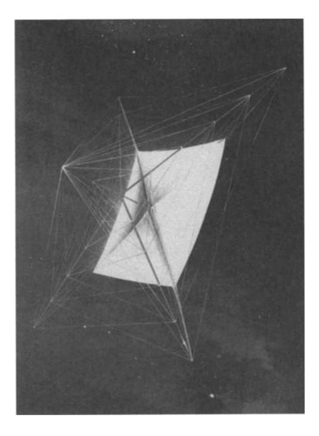
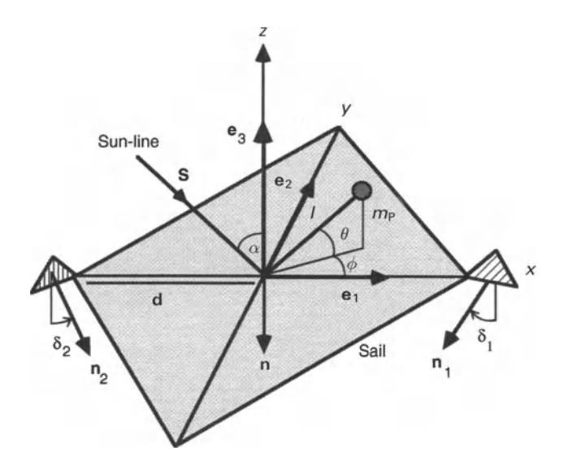
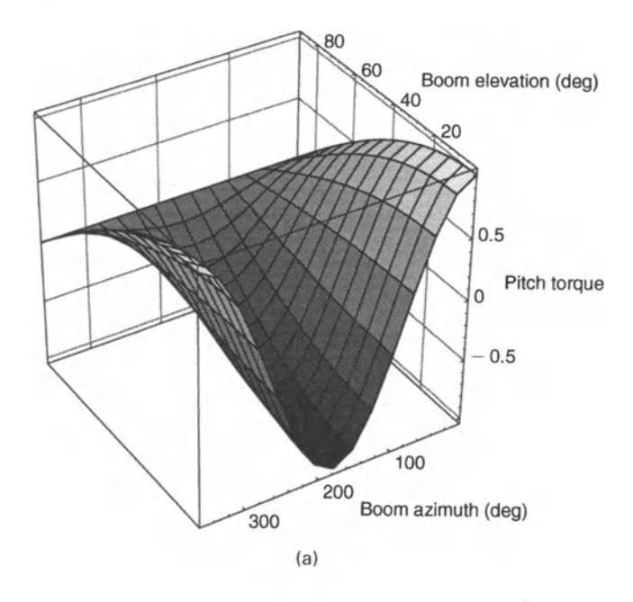
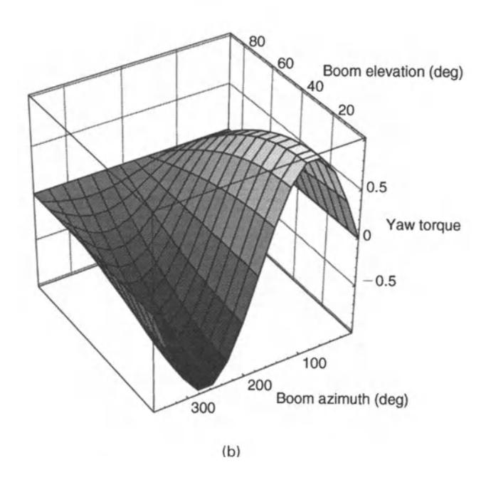
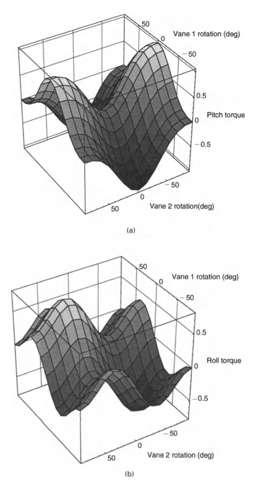

Fig. 3.12. Square solar sail deployment (NASA/JPL).

is almost edgewise to the Sun. Better control authority can be achieved through the use of small reflective vanes at the spar tips. Using combinations of vane rotations, arbitrary pitch, roll and yaw torques may be generated, even when the main sail is in a null attitude edgewise to the Sun-line. It can be shown that suitable control can in fact be achieved with vanes which only rotate about axes along the spars to which they are attached. In practice, combinations of more than one method may provide the optimal solution for good three-axis attitude control. The required control authority is, however, a function of the mission phase. Planet-centred escape or capture spiral trajectories place greater demands on the solar sail attitude control actuators than Sun-centred cruise trajectories.

Firstly, centre-of-mass offset control will be investigated. An ideal, flat solar sail will be considered with body axes *(x, y, z),* as shown in Fig. 3.13. Pitch rotations will be defined about the *+y* axis, yaw rotations about the *+x* axis and roll rotations about the +z axis. It will be assumed that the payload of mass *mp* is located at the end of a boom of fixed length *I* so that the position of the payload is defined in body axes as

$$\mathbf{r}_{P} = l\cos\theta\cos\phi\,\mathbf{e}_{1} + l\cos\theta\sin\phi\,\mathbf{e}_{2} + l\sin\theta\,\mathbf{e}_{3}$$
 (3.16)

where *e* is the boom elevation and ¢ is the boom azimuth relative to the solar sail body axes. These two boom angles then provide the controls for modulating the 78 Solar sail design [Ch. 3

Fig. 3.13. Square solar sail attitude control actuators.

torque exerted on the solar sail. If the mass of the solar sail excluding the payload is  $m_S$ , the position of the centre-of-mass  $\mathbf{r}_C$  is defined in body axes as

$$\mathbf{r}_{\mathrm{C}} = \frac{m_{\mathrm{P}}}{m_{\mathrm{P}} + m_{\mathrm{S}}} \mathbf{r}_{\mathrm{P}} \tag{3.17}$$

It can be seen that if the boom length is fixed, the centre-of-mass location can only be displaced over a hemispherical surface of radius  $m_P/(m_P + m_S)l$  on the sunward face of the solar sail. Since the solar sail is assumed to be ideal, the solar radiation pressure force acts in direction **n** normal to the sail surface. Then, the force f exerted on the solar sail is given by

$$f = \tilde{f}_{S}(\mathbf{S} \cdot \mathbf{n})^{2} \mathbf{n} \tag{3.18}$$

where **S** is the Sun-line vector and  $\tilde{f}_S$  is the force exerted on the solar sail when facing the Sun. For ease of illustration it will be assumed that the Sun-line is located in the x-z plane at an angle  $\alpha$  relative to the sail normal. Since the force vector does not act through the centre-of-mass of the solar sail, the torque **M** generated by the centre-of-mass offset is now defined to be

$$\mathbf{M} = -\mathbf{r}_{\mathbf{C}} \times f \tag{3.19}$$

where  $-\mathbf{r}_{C}$  is the point of action of the solar radiation pressure force vector relative to the solar sail centre-of-mass. Writing Eq. (3.19) in component form, the torque

generated about each body axis of the solar sail is found to be

$$M_{x} = \tilde{f}_{S} \frac{m_{P}}{m_{P} + m_{S}} l \cos^{2} \alpha \cos \theta \sin \phi$$
 (3.20a)

$$M_{y} = -\tilde{f}_{S} \frac{m_{P}}{m_{P} + m_{S}} l \cos^{2} \alpha \cos \theta \cos \phi$$
 (3.20b)

$$M_z = 0 (3.20c)$$

It can be seen from Eqs (3.20) that body pitch and yaw torques may be generated by a suitable choice of boom orientation, but that roll torques cannot be generated. However, it can be shown that, for a non-ideal solar sail, small roll torques are in fact generated since the solar radiation pressure force vector is no longer directed normal to the sail surface. In addition, it can also be seen that control torques cannot be generated when the solar sail is oriented edgewise to the Sun.

Normalised pitch and yaw torques are shown in Fig. 3.14 for an ideal solar sail in a Sun-facing attitude. It can be seen that the magnitude of the torque may be controlled using the boom elevation while the sign of the torque may be controlled using the boom azimuth. For a required set of control torques, Eqs (3.20) may then be used to obtain the necessary boom azimuth and elevation angles. In addition, Eqs (3.20) may also be used to size the boom length to generate the necessary maximum torques expected during the solar sail mission. It is clear then that the centre-of-mass offset can provide useful control torques for attitude control. However, an unintentional offset of the centre-of-mass and centre-of-pressure can easily generate bias torques which can dominate the nominal torques required for attitude manoeuvres. Such an unintentional offset can occur due to thermal bending of the spars, asymmetries in the mass and reflectivity properties of the sail film, and incomplete deployment of the solar sail structure. The control boom length must therefore be sized to compensate for any expected disturbance torques along with the manoeuvring torques required for attitude control.

As an alternative means of three-axis attitude control, the use of spar tip-mounted vanes will now be considered. The tip vanes are small reflective panels attached to the end of the spars through drive motors. Although the force generated by a tip vane is small, the large moment arm relative to the solar sail centre-of-mass can provide suitable control torques. For ease of illustration the solar sail will be assumed to have only two articulated vanes located at the tips of the x-axis spar structure, as shown in Fig. 3.13. While two vanes will only provide control in pitch and roll, it will be seen that yaw control may in fact be achieved through an appropriate combination of pitch and roll rotations of the entire solar sail. It will now be assumed that the vanes may only be rotated about the spar axis through a clockwise rotation 8. Then, the unit normal vector to each vane" may be written in the solar sail body axes as

$$\mathbf{n}_1 = \sin \delta_1 \, \mathbf{e}_2 - \cos \delta_1 \, \mathbf{e}_3 \tag{3.21a}$$

$$\mathbf{n}_2 = -\sin \delta_2 \, \mathbf{e}_2 - \cos \delta \, \mathbf{e}_3 \tag{3.21b}$$

Each tip vane will generate a torque which can be superimposed to provide a useful

Fig. 3.14. Normalised torque as a function of boom elevation *B* and azimuth (~ : (a) pitch torque; (b) yaw torque.

total control torque. Then, the control torque generated by the *ith* vane is obtained from

(3.22)

where diis the location of the ith vane relative to the solar sail centre-of-mass and Iv is the tip vane force obtained when facing the Sun. For spars of length *d* the control torque generated about each body axis of the solar sail may then be written in component form as

$$M_{x} = 0 \tag{3.23a}$$

$$M_{y} = \tilde{f}_{V} d\cos^{2}\alpha(\cos^{3}\delta_{1} - \cos^{3}\delta_{2})$$
(3.23b)

$$M_z = \tilde{f}_V d\cos^2\alpha(\cos^2\delta_1\sin\delta_1 + \cos^2\delta_2\sin\delta_2)$$
 (3.23c)

Therefore, through appropriate combinations of vane rotations, arbitrary pitch and roll torques may be generated with the roll torques generated through a collective rotation of both vanes. In addition to determining the required vanes angles, Eqs (3.23) may also be used to size the area of the tip vanes to generate the necessary maximum torques expected during the solar sail mission.

Normalised pitch and roll torques generated for an ideal solar sail facing the Sun are shown in Fig. 3.15. It can be seen that full control authority can now be achieved in both pitch and roll. If yaw control is only required infrequently, it can be demonstrated that full three-axis control can in fact be obtained with only two vanes located at the tips of the x-axis spar. The sail is firstly rolled by 90° using collective rotations of the two vanes. Then, the sail is pitched to the desired attitude and finally rolled back through 90°. This full sequence of rotations then corresponds to a change in the sail yaw attitude.

Tip vanes and centre-of-mass displacement each have their own particular advantages for solar sail attitude control. While tip vanes provide excellent control authority, actuators are required at the end of each spar. This may present additional demands for the sail structural design and pose problems for packing and deployment. In addition, the vane orientations must be accurately controlled to avoid the generation of unintentional disturbance torques, particularly in roll. While an articulated central boom does not provide a control authority as efficient as tip vanes, only a single gimbal actuator is required near the centre-of-mass of the solar sail. Boom rotations may not be problematic for passive experiments, but continual rotation of the payload may pose additional pointing difficulties for optical payloads and communication antennae.

## 3.5.3 Spin-stabilised heliogyro

## *3.5.3.1 I>esign*

Whereas the square solar sail relies on a rigid structure to provide tension at the edges of the sail film, the heliogyro has several long blades of film, rotating to provide tension and spin stabilisation. Invented in the late 1960s by Richard 82 **Solar sail design** [Ch.3

Fig. 3.15. Normalised torque as a function of vane 1 rotation *01* and vane 2 rotation *02:* (a) pitch torque; (b) roll torque.