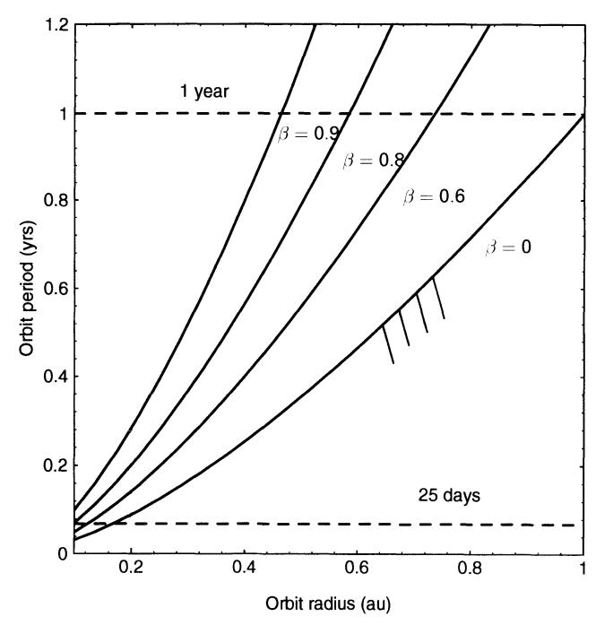
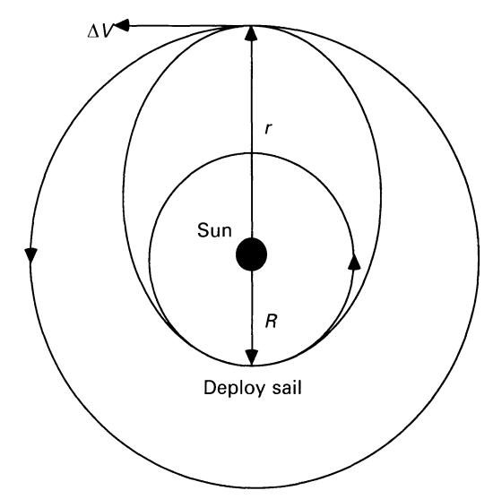
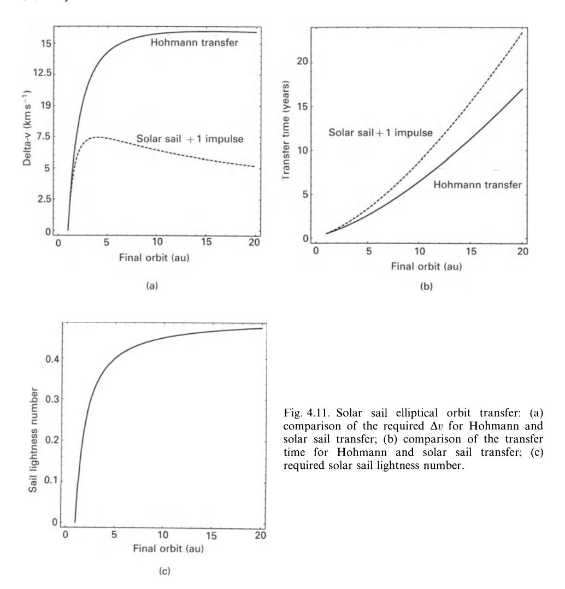
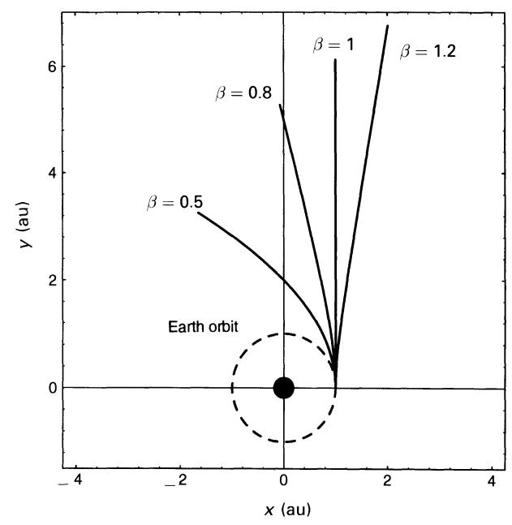

Fig. 4.9. Orbital period variation with solar sail lightness number.

In order to synchronise the solar sail orbit period T at some required value, the required solar sail lightness number at radius r must be chosen as

$$\beta = 1 - \frac{4\pi^2}{\mu} \frac{r^3}{T^2} \tag{4.25}$$

Two examples of particular interest are 1-year Earth synchronous orbits and orbits with a period in the order of 25 days, which are synchronous with the solar rotation. For circular Keplerian orbits the required orbit radii are 1 and 0.167 au (~ 36 solar radii) respectively. The variation of the solar sail orbit period with orbit radius is shown in Fig. 4.9 with these two orbit periods indicated. Again, the solar sail orbit period is always greater than the Keplerian orbit period at the same orbit radius since the effect of solar radiation pressure is to reduce the effective solar gravity experienced by the solar sail. It can also be seen that for orbits close to the Sun, the required solar sail lightness number quickly approaches unity for both the 1-year and 25-day orbits.

## 4.3.2.3 Elliptical orbits $(0 \le e \le 1)$

For elliptical orbits, the relationships for Keplerian orbits will again apply but with a modified gravitational parameter. Of particular interest is the case of a solar sail deployed on an Earth escape trajectory with an orbit radius R of 1 au. After

Sec. 4.3] **Sun-centred orbits** 125

Fig. 4.10. Solar sail single impulse transfer.

deployment, the solar sail will be moving in a Sun-centred orbit with the local circular orbit speed vi *ILl R.* However, owing to the reduced gravitational parameter this speed is greater than that required for a circular orbit. Therefore, after deployment the solar sail will move along an elliptical orbit, as shown in Fig. **4.1** O. Using the relationship for the speed on an elliptical orbit given by Eq. (4.20a), the following identity is seen to hold, viz.

$$\frac{\mu}{R} = \tilde{\mu} \left( \frac{2}{R} - \frac{1}{a} \right) \tag{4.26}$$

Therefore, the semi-major axis of the Sun-centred orbit obtained after deployment of the solar sail is given by

$$a = R\left(\frac{1-\beta}{1-2\beta}\right) \tag{4.27}$$

For bound orbits it can be seen that the solar sail lightness number is constrained such that 0-<,8-<~, as discussed in section 4.3.2.1. **In** addition, the perihelion distance *R* and aphelion distance *r* of the elliptical orbit are given by

$$R = a(1 - e) \tag{4.28a}$$

$$r = a(1+e) \tag{4.28b}$$

Therefore, using Eq. (4.27) to eliminate the orbit semi-major axis, the orbit eccentricity is found to be

$$e = 1 - \left(\frac{1 - 2\beta}{1 - \beta}\right) \tag{4.29}$$

Interestingly, it can be seen that the eccentricity of the orbit is independent of the initial circular orbit radius. Then, using Eq. (4.28b), the aphelion distance r may be written as

$$r = \frac{R}{1 - 2\beta} \tag{4.30}$$

Again, it can be seen that the sail lightness number is constrained to  $0 < \beta < \frac{1}{2}$  for bound orbits.

The use of elliptical orbits also provides the opportunity for Hohmann-type transfers, but using only a single impulse. Such a manoeuvre is shown in Fig. 4.10 for a transfer between circular co-planar orbits of radius R and r. The solar sail is again deployed on the initial circular orbit of radius R and, with the correct choice of lightness number, is transferred to an elliptical orbit with the aphelion located at the final circular orbit radius r. At the aphelion of the transfer ellipse the sail is then jettisoned and a single impulse used to circularise the orbit. From the orbit geometry the required semi-major axis of the transfer ellipse is given by

$$a = \frac{1}{2}(R+r) \tag{4.31}$$

Then, using Eq. (4.27) the solar sail lightness number required to attain an aphelion distance r may be written as

$$\beta = \frac{1}{2} \left( 1 - \frac{R}{r} \right) \tag{4.32}$$

In addition, the duration of the transfer may also be calculated from Eq. (4.19) as one half of the period of the elliptical transfer orbit, viz.

$$T_{\rm S} = \pi \left[ \frac{(R+r)^3}{8\mu(1-\beta)} \right]^{1/2} \tag{4.33}$$

Finally, the  $\Delta v$  required to circularise at the final orbit may be obtained from the difference between the solar sail speed and the circular orbit speed at the aphelion distance r as

$$\Delta v_{\rm S} = \sqrt{\frac{\mu}{r}} \left( 1 - \sqrt{\frac{R}{r}} \right) \tag{4.34}$$

The performance of a single impulse transfer using a solar sail will now be compared with a standard Hohmann transfer. For the Hohmann transfer two impulses are required. The first impulse injects the spacecraft onto the transfer ellipse while the second impulse circularises the spacecraft at the final orbit. The solar sail transfer mode therefore eliminates the need for an initial impulse. The required  $\Delta v$ , transfer time and solar sail lightness number are shown in Fig. 4.11 for a range of final orbits up to 20 au. It can be seen that the cost for the solar sail transfer  $\Delta v_s$  has a maximum at 4 au and then tends asymptotically to zero. This limit corresponds to an escape orbit using a solar sail with a lightness number of 0.5. However, the Hohmann cost  $\Delta v_H$  has a maximum at 15.58 au and tends asymptotically to 12.34 km s-1, which is

Sec. 4.3] Sun-centred orbits 127

the solar system escape  $\Delta v$  from 1 au. Using the above analysis the requirements for particular transfers can be found, as listed in Table 4.1. It can be seen that the solar sail transfer can provide a significant reduction in  $\Delta v$ , but at the expense of an increased transfer time, with the solar sail transfer time  $T_{\rm S}$  always greater than that for the Hohmann transfer time  $T_{\rm H}$ . This reduction in  $\Delta v$  must, of course, be offset against the required solar sail mass.

## 4.3.2.4 Rectilinear orbits $(e \rightarrow \infty)$

If the solar sail lightness number is now chosen as  $\beta = 1$ , no nett force will be exerted on the solar sail. The solar sail will completely remove the effect of solar gravity. Since solar radiation pressure and solar gravity both scale as inverse square laws

|                                        | Mars | Jupiter | Saturn | Uranus | Escape   |
|----------------------------------------|------|---------|--------|--------|----------|
| a (au)                                 | 1.52 | 5.20    | 9.55   | 19.13  | $\infty$ |
| $\Delta v_{\rm H} ~({\rm km  s^{-1}})$ | 5.60 | 14.44   | 15.74  | 15.95  | 12.34    |
| T H (years)                 | 0.71 | 2.73    | 6.06   | 15.97  | $\infty$ |
| $\Delta v_{\rm S}  ({\rm km  s^{-1}})$ | 4.58 | 7.34    | 6.52   | 5.26   | 0        |
| T S (years)                 | 0.78 | 3.54    | 8.15   | 22.01  | $\infty$ |
| β                                      | 0.17 | 0.40    | 0.45   | 0.47   | 0.5      |

**Table 4.1.** Single impulse solar sail transfer

(apart from close to the Sun, as discussed in section 2.5) the solar sail can then remain at rest in any location relative to the Sun. In addition, if the solar sail has some initial velocity relative to the Sun, it will move along a rectilinear trajectory with constant speed. For example, if a solar sail of unit lightness number is injected into an Earth escape trajectory and then deployed in a circular orbit at 1 au, it will move along a rectilinear trajectory away from the Sun at 29.78 km s-1, the circular orbit speed of the Earth. If the solar sail is deployed on a circular Sun-centred orbit at some radius R, the speed and linear distance traversed are given by

$$v = \sqrt{\frac{\mu}{R}} \tag{4.35a}$$

and

$$s = \sqrt{\frac{\mu}{R}} \left( t - t_0 \right) \tag{4.35b}$$

so that the radial distance of the solar sail from the Sun is given by

$$r(t) = R \left[ 1 + \frac{\mu}{R^3} (t - t_0)^2 \right]^{1/2}$$
 (4.36)

Since the efficiency of such a trajectory is a function of the initial solar sail speed, there is a strong motivation to manoeuvre the solar sail close to the Sun before rotating the sail to face the Sun and so begin the rectilinear trajectory.

As the solar sail moves along the rectilinear trajectory its osculating semi-major axis and eccentricity will continually increase. These are the instantaneous orbital elements which would be obtained if the sail were to be jettisoned. In particular, the solar sail will quickly reach a distance from the Sun where its speed v is equal to the local escape speed  $\sqrt{2\mu/r}$ . This transition to escape occurs at a heliocentric distance of 2R. For a rectilinear trajectory starting from 1 au it is found from Eq. (4.36) that the transition occurs after only 100.86 days. After this time, even of the sail is jettisoned or fails, the payload will be moving on a solar system escape trajectory.

## 4.3.2.5 Escape orbits $(e \ge 1)$

As discussed in section 4.3.2.1, escape orbits are possible directly through the choice of solar sail lightness number, with  $\beta = \frac{1}{2}$  providing parabolic escape. Of particular

Sec. 4.3] Sun-centred orbits 129

Fig. 4.12. Families of escape orbits.

interest are the family of hyperbolic orbits obtained with a sail lightness number greater than unity. In this case the effective force exerted on the solar sail follows an inverse square law, but the force is directed radially outwards, away from the Sun. Since the effective force is inverse square, the orbit is still a conic section.

A selection of escape trajectories are shown in Fig. 4.12 for a duration of one year. Although the fabrication of a solar sail with a high lightness number is a significant challenge, the performance leverage apparent from Fig. 4.12 is quite remarkable. It can be seen that for a solar sail lightness number of greater than unity the hyperbolic orbit inverts so that the Sun occupies the opposite focus of the conic section. The mission applications of such high-performance solar sails will be considered in Chapter 6.

## 4.3.3 Logarithmic spiral trajectories

Logarithmic spiral trajectories may in principle be generated for any type of spacecraft using continuous low-thrust propulsion. However, it is found that this type of trajectory requires the spacecraft thrust-induced acceleration to have an inverse square variation with orbit radius. Since this is clearly the case for solar sails, logarithmic spiral trajectories appear to be an attractive option for interplanetary transfer. In addition, since the sail attitude must be fixed relative to the Sun-line, only a simple steering law is required. A principal characteristic of the logarithmic spiral trajectory is that the solar sail velocity vector maintains a fixed angle with respect to the instantaneous radius vector throughout the transfer. As will be seen, this

characteristic of the trajectory leads to difficulties in the practical application of logarithmic spirals for interplanetary transfer. For transfers between circular orbits, the initial and final solar sail velocity vector will not match that of the initial and final orbits. Therefore, a significant hyperbolic excess is required at launch to inject the solar sail onto the logarithmic spiral trajectory. Similarly, on arrival the solar sail again has a significant hyperbolic excess relative to the final orbit. The hyperbolic excess is a measure of the energy required from a kick-stage to inject the solar sail onto the logarithmic spiral, above that required for an Earth escape trajectory. The arrival hyperbolic excess can be removed again by using a kick-stage or, if appropriate, jettisoning the solar sail and aerobraking the payload.

In order to investigate the dynamics of logarithmic spiral trajectories the solar sail equations of motion will now be considered in the ecliptic plane with a clock angle  $\delta$  of 90°. Therefore, the sail attitude is defined solely by the cone angle  $\alpha$ . In this planar case the sail cone angle will also be referred to as the sail pitch angle, as discussed earlier. From Eqs (4.13), the Sun-centred equations of motion in plane polar coordinates may be written as

$$\frac{\mathrm{d}^2 r}{\mathrm{d}r^2} - r \left(\frac{\mathrm{d}\theta}{\mathrm{d}t}\right)^2 = -\frac{\mu}{r^2} + \beta \frac{\mu}{r^2} \cos^3 \alpha \tag{4.37a}$$

$$r\frac{\mathrm{d}^2\theta}{\mathrm{d}t^2} + 2\left(\frac{\mathrm{d}r}{\mathrm{d}t}\right)\left(\frac{\mathrm{d}\theta}{dt}\right) = \beta\frac{\mu}{r^2}\cos\alpha^2\sin\alpha \tag{4.37b}$$

It can be seen that the effect of the radial component of the solar radiation pressure force is to reduce the effective gravitational force exerted on the solar sail while the transverse component changes the angular momentum of the orbit. For a fixed sail pitch angle  $\alpha$  particular solution to these equations of motion is found to be

$$r(\theta) = r_0 \exp(\theta \tan \gamma) \tag{4.38}$$

where the spiral angle  $\gamma$  is the angle between the solar sail velocity vector and the transverse direction, as shown in Fig. 4.13. In order to investigate the consequences of this logarithmic spiral solution, Eq. (4.38) is firstly differentiated to obtain the radial velocity and acceleration as

$$\frac{\mathrm{d}r}{\mathrm{d}t} = r \tan \gamma \frac{\mathrm{d}\theta}{\mathrm{d}t} \tag{4.39a}$$

$$\frac{\mathrm{d}^2 r}{\mathrm{d}t^2} = \left[ \tan \gamma \frac{\mathrm{d}^2 \theta}{\mathrm{d}t^2} + \tan^2 \gamma \left( \frac{\mathrm{d}\theta}{\mathrm{d}t} \right)^2 \right] r \tag{4.39b}$$

These relations can now be used to eliminate the radial velocity and acceleration terms in Eqs (4.37) to obtain

$$r\left[\frac{\mathrm{d}^2\theta}{\mathrm{d}t^2}\tan\gamma + \left(\frac{\mathrm{d}\theta}{\mathrm{d}t}\right)^2\tan^2\gamma\right] - r\left(\frac{\mathrm{d}\theta}{\mathrm{d}t}\right)^2 = -\frac{\mu}{r^2} + \beta\frac{\mu}{r^2}\cos^2\alpha \qquad (4.40a)$$

$$r\left[\frac{\mathrm{d}^2\theta}{\mathrm{d}t^2} + 2\left(\frac{\mathrm{d}\theta}{\mathrm{d}t}\right)^2 \tan\gamma\right] = \beta \frac{\mu}{r^2} \cos\alpha^2 \sin\alpha \tag{4.40b}$$