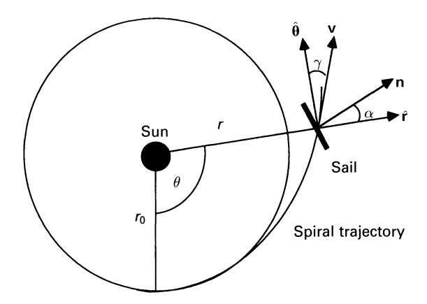
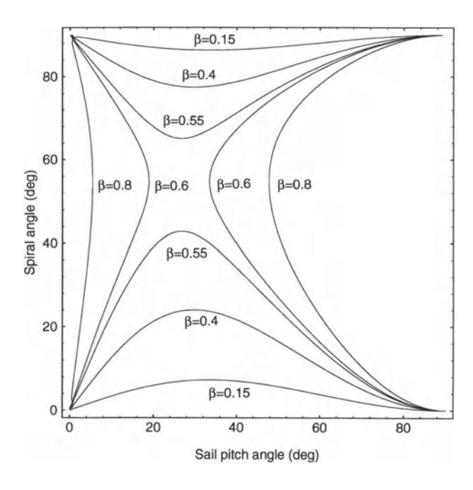
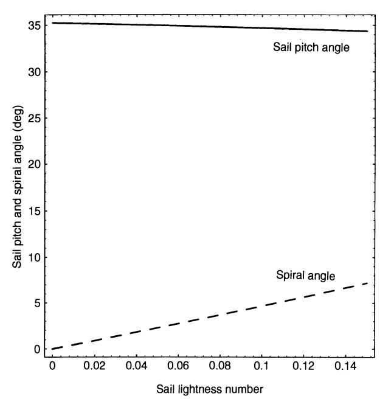
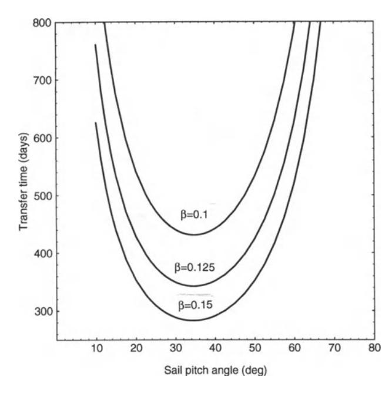
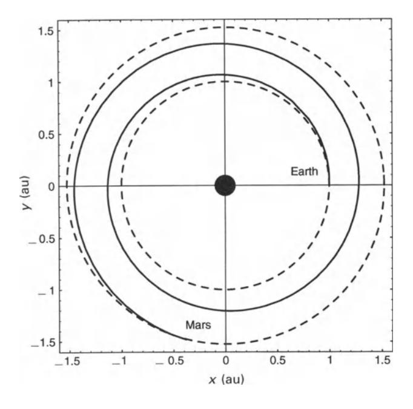
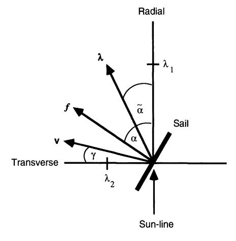

characteristic of the trajectory leads to difficulties in the practical application of logarithmic spirals for interplanetary transfer. For transfers between circular orbits, the initial and final solar sail velocity vector will not match that of the initial and final orbits. Therefore, a significant hyperbolic excess is required at launch to inject the solar sail onto the logarithmic spiral trajectory. Similarly, on arrival the solar sail again has a significant hyperbolic excess relative to the final orbit. The hyperbolic excess is a measure of the energy required from a kick-stage to inject the solar sail onto the logarithmic spiral, above that required for an Earth escape trajectory. The arrival hyperbolic excess can be removed again by using a kick-stage or, if appropriate, jettisoning the solar sail and aerobraking the payload.

In order to investigate the dynamics of logarithmic spiral trajectories the solar sail equations of motion will now be considered in the ecliptic plane with a clock angle  $\delta$  of 90°. Therefore, the sail attitude is defined solely by the cone angle  $\alpha$ . In this planar case the sail cone angle will also be referred to as the sail pitch angle, as discussed earlier. From Eqs (4.13), the Sun-centred equations of motion in plane polar coordinates may be written as

$$\frac{\mathrm{d}^2 r}{\mathrm{d}r^2} - r \left(\frac{\mathrm{d}\theta}{\mathrm{d}t}\right)^2 = -\frac{\mu}{r^2} + \beta \frac{\mu}{r^2} \cos^3 \alpha \tag{4.37a}$$

$$r\frac{\mathrm{d}^2\theta}{\mathrm{d}t^2} + 2\left(\frac{\mathrm{d}r}{\mathrm{d}t}\right)\left(\frac{\mathrm{d}\theta}{dt}\right) = \beta\frac{\mu}{r^2}\cos\alpha^2\sin\alpha \tag{4.37b}$$

It can be seen that the effect of the radial component of the solar radiation pressure force is to reduce the effective gravitational force exerted on the solar sail while the transverse component changes the angular momentum of the orbit. For a fixed sail pitch angle  $\alpha$  particular solution to these equations of motion is found to be

$$r(\theta) = r_0 \exp(\theta \tan \gamma) \tag{4.38}$$

where the spiral angle  $\gamma$  is the angle between the solar sail velocity vector and the transverse direction, as shown in Fig. 4.13. In order to investigate the consequences of this logarithmic spiral solution, Eq. (4.38) is firstly differentiated to obtain the radial velocity and acceleration as

$$\frac{\mathrm{d}r}{\mathrm{d}t} = r \tan \gamma \frac{\mathrm{d}\theta}{\mathrm{d}t} \tag{4.39a}$$

$$\frac{\mathrm{d}^2 r}{\mathrm{d}t^2} = \left[ \tan \gamma \frac{\mathrm{d}^2 \theta}{\mathrm{d}t^2} + \tan^2 \gamma \left( \frac{\mathrm{d}\theta}{\mathrm{d}t} \right)^2 \right] r \tag{4.39b}$$

These relations can now be used to eliminate the radial velocity and acceleration terms in Eqs (4.37) to obtain

$$r\left[\frac{\mathrm{d}^2\theta}{\mathrm{d}t^2}\tan\gamma + \left(\frac{\mathrm{d}\theta}{\mathrm{d}t}\right)^2\tan^2\gamma\right] - r\left(\frac{\mathrm{d}\theta}{\mathrm{d}t}\right)^2 = -\frac{\mu}{r^2} + \beta\frac{\mu}{r^2}\cos^2\alpha \qquad (4.40a)$$

$$r\left[\frac{\mathrm{d}^2\theta}{\mathrm{d}t^2} + 2\left(\frac{\mathrm{d}\theta}{\mathrm{d}t}\right)^2 \tan\gamma\right] = \beta \frac{\mu}{r^2} \cos\alpha^2 \sin\alpha \tag{4.40b}$$

Sec. 4.3] **Sun-centred orbits** 131

Fig. 4.13. Logarithmic spiral trajectory.

Therefore, combining Eqs (4.40) to eliminate the angular acceleration term it IS found that

$$r^{3} \left(\frac{\mathrm{d}\theta}{\mathrm{d}t}\right)^{2} = \mu[1 - \beta\cos^{2}\alpha(\cos\alpha - \tan\gamma\sin\alpha)]\cos^{2}\gamma \tag{4.41}$$

This equation represents a modified form of Kepler's third law, which is recovered when *f3* = O. For (3 *oj=.* 0 it is clear that the logarithmic spiral is non-Keplerian, with a reduced effective gravitational parameter.

Using Eq. (4.41) the transverse component of the solar sail velocity vector *Ve* = *rB*  may now be obtained as

$$v_{\theta} = \sqrt{\frac{\mu}{r}} \left[ 1 - \beta \cos^2 \alpha (\cos \alpha - \tan \gamma \sin \alpha) \right]^{1/2} \cos \gamma \tag{4.42}$$

However, *B* may also be related to *r* using Eq. (4.39a) so that the radial component of the solar sail velocity vector *Vr* =*r* is obtained as

$$v_r = \sqrt{\frac{\mu}{r}} \left[ 1 - \beta \cos^2 \alpha (\cos \alpha - \tan \gamma \sin \alpha) \right]^{1/2} \sin \gamma \tag{4.43}$$

Therefore, the magnitude of the solar sail velocity is then easily obtained from Eqs (4.42) and (4.43) as

$$v(r) = \sqrt{\frac{\mu}{r}} \left[ 1 - \beta \cos^2 \alpha (\cos \alpha - \sin \alpha \tan \gamma) \right]^{1/2}$$
 (4.44)

It can be seen that the solar sail speed is always less than the local circular orbit speed so that there will indeed be a discontinuity at the boundary conditions for transfers between circular orbits, as discussed earlier.

Fig. 4.14. Sail pitch angle and spiral angle with contours of equal sail lightness number.

By combining the solar sail velocity components with the equations of motion it may be shown that there is an implicit relationship between the sail pitch angle  $\alpha$  and the spiral angle  $\gamma$ , viz.

$$\frac{\sin\gamma\cos\gamma}{2-\sin^2\gamma} = \frac{\beta\cos^2\alpha\sin\alpha}{1-\beta\cos^3\alpha} \tag{4.45}$$

Therefore, for a given solar sail lightness number Eq. (4.45) may be solved for the required sail pitch angle and spiral angle, as shown in Fig. 4.14. For small values of lightness number there are two classes of admissible solution corresponding to spiral angles close to  $0^{\circ}$  or  $90^{\circ}$ . Owing to launch energy requirements, only the lower branch of solutions are of interest. Similarly, for large values of lightness number there are again two classes of solution corresponding to sail pitch angles close to  $0^{\circ}$  or  $90^{\circ}$ . Again, only solutions with small spiral angles will be of interest.

Using Eq. (4.45) to simplify Eq. (4.43), the transfer time between the initial orbit radius  $r_0$  and some radial distance r may be obtained by integration of the radial component of the solar sail velocity as

$$\int_{r_0}^r \sqrt{r} \, \mathrm{d}r = \int_{t_0}^t (2\beta\mu \sin\alpha \cos^2\alpha \tan\gamma)^{1/2} \mathrm{d}t \tag{4.46}$$

Therefore, integrating Eq. (4.46) the transfer time between any two orbits is obtained as

$$t - t_0 = \frac{1}{3} (r^{3/2} - r_0^{3/2}) \left( \frac{2 \cot \gamma}{\beta \mu \sin \alpha \cos^2 \alpha} \right)^{1/2}$$
 (4.47)

For a given solar sail lightness number, optimal logarithmic spiral trajectories may be obtained by calculating the value of the sail pitch angle which minimises the transfer time between orbits. However, this optimisation must also use Eq. (4.45) to obtain the correct spiral angle for a given solar sail lightness number and pitch angle. Since Eq. (4.45) is implicit, the optimisation requires numerical methods.

However, since only small spiral angles are of interest due to launch energy requirements, it is found that Eq. (4.45) may be approximated to obtain

$$\tan \gamma = \frac{2\beta \cos^2 \alpha \sin \alpha}{1 - \beta \cos^3 \alpha} \tag{4.48}$$

so that the spiral angle may be obtained as an explicit function of the solar sail lightness number and the sail pitch angle. **In** addition, using this approximation the transfer time is then given by

$$t - t_0 = \frac{1}{3} (r^{3/2} - r_0^{3/2}) \left( \frac{1 - \beta \cos^3 \alpha}{\beta^2 \mu \cos^4 \alpha \sin^2 \alpha} \right)^{1/2}$$
 (4.49)

so that the calculation of minimum time transfers now corresponds to minimising the function

$$f(\alpha) = \frac{(1 - \beta \cos^3 \alpha)^{1/2}}{\beta \cos^2 \alpha \sin \alpha}$$
 (4.50)

with respect to the sail pitch angle. Settingf' (0:) = 0 it can be shown that there is an implicit relationship between the solar sail lightness number and the optimal sail pitch angle 0:\* which minimises the transfer time, viz.

$$\beta - \frac{2}{\cos \alpha^*} \frac{1 - 2\tan^2 \alpha^*}{2 - \tan^2 \alpha^*} = 0 \tag{4.51}$$

Therefore, for a given solar sail lightness number, Eq. (4.51) may be solved to obtain the required sail pitch angle, with the required spiral angle provided by Eq. (4.48). The variation of the optimal sail pitch angle and spiral angle is shown in Fig. 4.15 for small values of solar sail lightness number. It can be seen that the optimal sail pitch angle is always close to 35.26°, the sail pitch angle which maximises the transverse component of the solar radiation pressure force, as discussed in section 4.2.2. **In**  addition, the required spiral angle slowly increases with solar sail lightness number. However, this increase in spiral angle corresponds to a significant increase in launch energy, as will be seen below.

**In** order to evaluate the utility of the logarithmic spiral trajectory an Earth-Mars transfer will be investigated. It will be assumed that the transfer is between circular, co-planar orbits from the Earth at 1 au to Mars at 1.524 au. Solar sail lightness numbers of 0.05, 0.1, 0.125 and 0.15 will be considered to illustrate the trajectories

Fig. 4.15. Sail pitch and trajectory spiral angle as a function of solar sail lightness number.

Table 4.2. Earth-Mars logarithmic spiral trajectories

| {3             | Hohmann | 0.05  | 0.1   | 0.125 | 0.15  |
|----------------|---------|-------|-------|-------|-------|
| ao (mms-2)     |         | 0.30  | 0.60  | 0.75  | 0.89  |
| a (deg)        |         | 34.98 | 34.68 | 34.53 | 34.37 |
| I (deg)        |         | 2.66  | 4.66  | 5.90  | 7.18  |
| T (days)       | 259     | 875   | 431   | 342   | 283   |
| L\vI (kms-I)   | 2.95    | 1.54  | 2.52  | 3.17  | 3.84  |
| L\V2 (km s -I) | 2.65    | 1.25  | 2.10  | 2.57  | 3.11  |
| L\v-r (km S-I) | 5.60    | 2.79  | 4.62  | 5.74  | 6.95  |

generated for a range of sail performances. Firstly, the optimal sail pitch angle and spiral angle may be calculated from Eqs (4.51) and (4.48). The resulting parameters are listed in Table. 4.2. Again, it can be seen that the optimal sail pitch angle is always close to 35.26° with little variation as the solar sail lightness number increases. The transfer time *T* may then be calculated from Eq. (4.47) with the resulting times again listed in Table 4.2. It can be seen that for a lightness number of 0.15 the spiral trajectory still has a longer duration than a conventional two-impulse Hohmann transfer. In addition, the variation of transfer time with sail pitch angle is shown in Fig. 4.16, where it can be seen that the transfer time is relatively insensitive to small variations in the sail pitch angle. A typical logarithmic spiral trajectory is shown in Fig. 4.17 for a lightness number of 0.05.

Sec. 4.3] **Sun-centred orbits** 135

Fig. 4.16. Earth~Mars transfer time as a function of solar sail lightness number and sail pitch angle.

Fig. 4.17. Earth-Mars logarithmic spiral trajectory.

In order to evaluate fully the logarithmic spiral trajectory for interplanetary transfer, the hyperbolic excess required to inject the solar sail onto a logarithmic spiral trajectory is required. Since the spiral angle is constant the initial hyperbolic excess may be calculated using

$$\Delta v_1^2 = v_E^2 + v_0^2 - 2v_E v_0 \cos \gamma \tag{4.52a}$$

where *VE* is the circular orbit speed of the Earth and *Vo* is the speed of the solar sail at the start of the spiral, obtained from Eq. (4.44). Similarly, the hyperbolic excess on arrival at Mars is given by

$$\Delta v_2^2 = v_{\rm M}^2 + v_{\rm f}^2 - 2v_{\rm M}v_{\rm f}\cos\gamma \tag{4.52b}$$

where *VM* is the circular orbit speed of Mars and *Vr* is the speed of the solar sail at the end of the spiral. The resulting initial and final hyperbolic excess and the total hyperbolic excess *,1vT* for the complete transfer are listed in Table. 4.2. It can be seen that the logarithmic spiral trajectory does not appear attractive in comparison to the conventional Hohmann transfer owing to the large hyperbolic excess required at the boundaries of the transfer. Only trajectories with low solar sail lightness numbers and long transfer times show any benefit. As will be seen later in this chapter, the initial and final hyperbolic excess can be removed completely using optimal control theory to generate minimum time trajectories which accurately satisfy the boundary conditions of the transfer. Such optimal trajectories do, however, incur significantly more complex steering laws than the simple logarithmic spiral.

Although the logarithmic spiral does not appear attractive for interplanetary transfer with boundary conditions to enforce, it does provide a simple trajectory with a monotonically increasing or decreasing orbit radius. This property, along with the simple sail steering law, may be attractive for some mission applications to map, for example, spatial variations in the properties of the solar wind. Such mission applications will be considered in Chapter 6.

## **4.3.4 Locally optimal trajectories**

Although optimal control theory can generate true minimum time trajectories, there are many instances when only simple manoeuvre strategies are required. For example, transferring a solar sail to a close heliocentric orbit, or increasing its inclination using a cranking orbit. Such manoeuvres can be efficiently generated using simple sail-steering laws. To demonstrate this it will now be shown that a large class of locally optimal trajectories can be generated through the use of such simple steering laws. These control laws maximise the instantaneous rate of change of a particular orbital element, or combination of elements, and provide the required sail orientation in closed, analytic form. It should be noted that locally optimal control laws do not guarantee global optimality. Global optimality over an entire trajectory requires numerical methods, which will be discussed in section 4.3.5. However, in some instances these locally optimal laws can generate near optimal results when used in appropriate combination.

Firstly, the variational equations defined in section 4.2.4 will be written in the following form for some arbitrary orbital element Z, viz.

$$\frac{\mathrm{d}Z}{\mathrm{d}f} = \lambda(Z) \cdot f \tag{4.53}$$

where A = (>1], *A2, A3)* is a vector of functions of the solar sail orbital elements and *f* = (S, *T, W)* is the solar radiation pressure force exerted on the solar sail. In order to maximise the rate of change of some particular orbital element it is clear that the projection of the solar radiation pressure force vector along the vector A must be maximised. The component of solar radiation pressure force in this desired direction is given by

$$f_{\lambda} = 2PA(\mathbf{n} \cdot \hat{\mathbf{r}})^2 \,\mathbf{n} \cdot \lambda \tag{4.54}$$

The optimal sail cone and clock angles are then obtained using the same procedure as discussed in section 4.2.2 - that is, the optimal solar sail attitude angles *(a\*,8\*)*  are chosen to maximise the force in direction *(a,* 8), where a and 8 are the cone and clock angles of the vector A-

For changes to the solar sail semi-major axis and eccentricity, only in-plane forces are required so that *W* = O. The cone and clock angles of the required force direction are then given by

$$\tan \tilde{\alpha} = \left(\frac{\lambda_2}{\lambda_1}\right) \tag{4.55a}$$

$$\tilde{\delta} = \frac{\pi}{2} \tag{4.55b}$$

as shown in Fig. 4.18. The optimal solar sail cone and clock angles to maximise the component of solar radiation pressure force in this direction are then obtained using

Fig. 4.18. Required force vector for locally optimal trajectories.