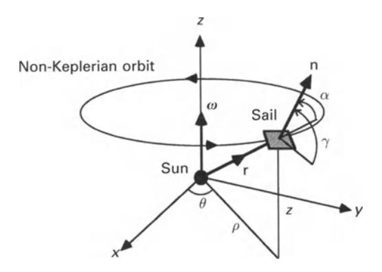
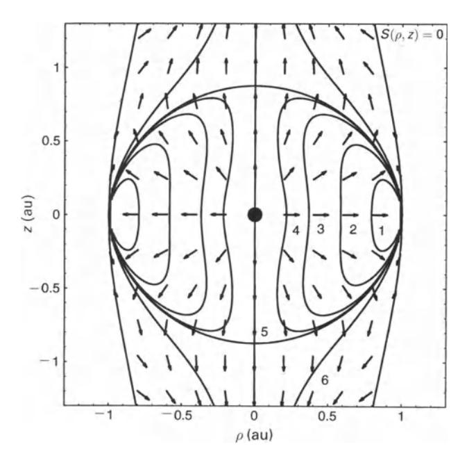
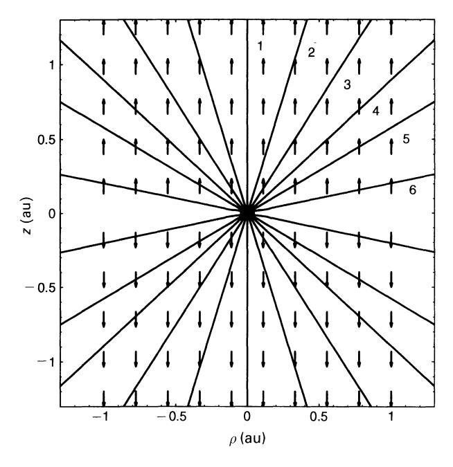
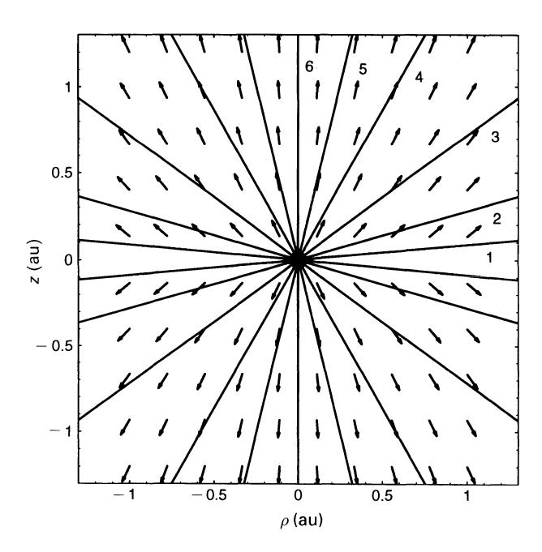
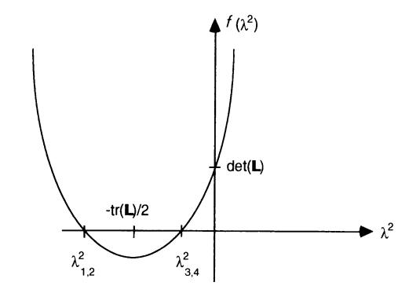
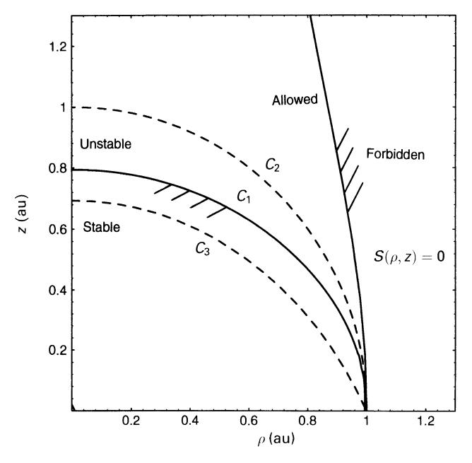
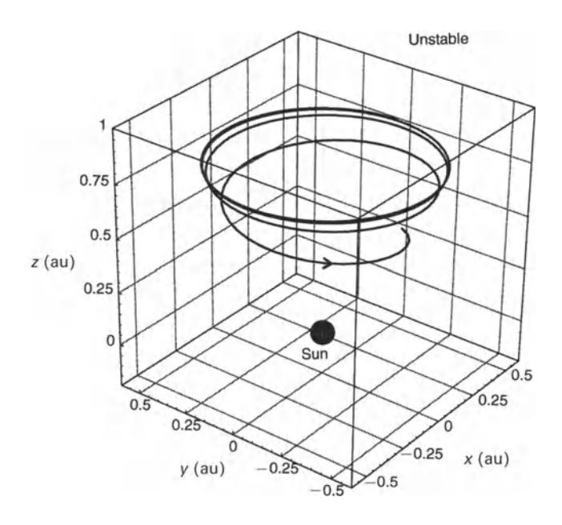

Fig. 5.1. Sun-centred non-Keplerian orbit frame of reference.

frame of reference rotating with angular velocity  $\omega$ , as shown in Fig. 5.1. The sail orientation is again defined by a unit vector  $\mathbf{n}$ , fixed in the rotating frame of reference, and the solar sail performance is characterised by the solar sail lightness number  $\beta$ . Since the sail orientation is fixed in the rotating frame, the solar sail must rotate once per orbit with respect to an inertial frame. The equation of motion for the solar sail in this rotating frame of reference may then be written as

$$\frac{\mathrm{d}^2 \mathbf{r}}{\mathrm{d}t^2} + 2\mathbf{\omega} \times \frac{\mathrm{d}\mathbf{r}}{\mathrm{d}t} + \mathbf{\omega} \times (\mathbf{\omega} \times \mathbf{r}) = \mathbf{a} - \nabla V \tag{5.1}$$

where the terms on the left of Eq. (5.1) represent the kinematic, coriolis and centripetal accelerations respectively. These accelerations are equated to the solar radiation pressure acceleration **a** and solar gravitational acceleration  $-\nabla V$  exerted on the solar sail. The solar radiation pressure acceleration and the two-body gravitational potential V are given by

$$\mathbf{a} = \beta \frac{\mu}{r^2} (\hat{\mathbf{r}} \cdot \mathbf{n})^2 \mathbf{n} \tag{5.2a}$$

$$V = -\frac{\mu}{r} \tag{5.2b}$$

as defined in section 2.3.3. Since the solar radiation pressure acceleration can never be directed sunward, the constraint  $\hat{\mathbf{r}} \cdot \mathbf{n} \ge 0$  is imposed so that the sail pitch angle is always less than 90°. It is now noted that the centripetal term in Eq. (5.1) is conservative and so may be written in terms of a scalar potential  $\Phi$  defined such that

$$\Phi = -\frac{1}{2}|\mathbf{\omega} \times \mathbf{r}|^2 \tag{5.3a}$$

$$\nabla \Phi = \mathbf{\omega} \times (\mathbf{\omega} \times \mathbf{r}) \tag{5.3b}$$

A new modified potential,  $U = V + \Phi$ , will now be defined so that a reduced

equation of motion is obtained, viz.

$$\frac{\mathrm{d}^2 \mathbf{r}}{\mathrm{d}t^2} + 2\mathbf{\omega} \times \frac{\mathrm{d}\mathbf{r}}{\mathrm{d}t} + \nabla U = \mathbf{a}$$
 (5.4)

In the rotating frame of reference an equilibrium solution is required so that the first two terms of Eq. (5.4) must vanish. Since the vector a is oriented in direction n, taking the vector product of n with Eq. (5.4) it is found that

$$\nabla U \times \mathbf{n} = 0 \Rightarrow \mathbf{n} = \varepsilon \nabla U \tag{5.5}$$

where c: is an arbitrary scalar multiplier. Using the normalisation condition Inl = 1, c: is then identified as *IV'UI-I* so that the required sail attitude is defined simply by

$$\mathbf{n} = \frac{\nabla U}{|\nabla U|} \tag{5.6}$$

Since the solar sail is to have uniform azimuthal motion, there can be no component of the vector n, and so of a, in the azimuthal direction. Therefore n is contained in the plane spanned by rand 00 so that the sail attitude may be described solely in terms of the pitch angle a between nand r. Taking vector and scalar products of Eq. (5.6) with r it is found that

$$\tan \alpha = \frac{|\hat{\mathbf{r}} \times \nabla U|}{\hat{\mathbf{r}} \cdot \nabla U} \tag{5.7}$$

Similarly, the required solar sail lightness number is obtained by taking a scalar product of Eq. (5.4) with n, again requiring an equilibrium solution, viz.

$$\beta = \frac{r^2}{\mu} \frac{\nabla U \cdot \mathbf{n}}{(\hat{\mathbf{r}} \cdot \mathbf{n})^2} \tag{5.8}$$

General functions for the solar sail attitude and lightness number have now been obtained in terms of the two-body rotating potential function *U.* For a given orbit period, orbit radius and displacement distance the solar sail pitch angle and lightness number can then be obtained.

lfthe set of cylindrical co-ordinates *(p, e,* z) shown in Fig. 5.1 are now used, the rotating two-body potential function may be written as

$$U = -\left(\frac{1}{2}\rho^2\omega^2 + \frac{\mu}{r}\right) \tag{5.9}$$

where the angular velocity *w* is related to the orbit period *T* by *w* = 271"/ *T.* Evaluating the potential gradient in Eqs (5.7) and (5.8) it is found that

$$\tan \alpha = \frac{(z/\rho)(\omega/\tilde{\omega})^2}{(z/\rho)^2 + [1 - (\omega/\tilde{\omega})^2]}, \quad \tilde{\omega}^2 = \frac{\mu}{r^3}$$
 (5.10a)

$$\beta = \left[1 + \left(\frac{z}{\rho}\right)^2\right]^{1/2} \frac{\{(z/\rho)^2 + [1 - (\omega/\tilde{\omega})^2]^2\}^{3/2}}{\{(z/\rho)^2 + [1 - (\omega/\tilde{\omega})^2]\}^2}$$
(5.10b)

where *w* is the orbital angular velocity of a circular Keplerian orbit of radius *r.* For convenience, the parameter *J.l* may now be chosen to be unity so that the unit of distance becomes the astronomical unit and the non-dimensional unit of time becomes (27f)~1 years. These expressions for the solar sail pitch angle and lightness number may now be used to investigate various families of non-Keplerian orbits. It can be seen that Eqs (5.10) are a function of z/ *p* and *w/w* only so that the expressions have a scale invariance. In addition, the expressions are also independent of the azimuthal angle *e.* Therefore, for a fixed solar sail lightness number, Eq. (5.l0b) defines nested surfaces of revolution about the *z* axis.

## *5.2.2.1 l'ype I*

For this family of orbits the solar sail orbit period will be chosen to be some fixed value for all values of orbit radius and displacement. For example, a family of Earth synchronous one-year orbits are generated by setting *w* = 1 in Eq. (5.IOb). A section of the surfaces of equal solar sail lightness number generated by Eq. (5.lOb) are shown in Fig. 5.2. In addition, the equivalent solar sail characteristic acceleration and loading values are listed in Table. 5.1. Each point on a surface of constant solar sail lightness number corresponds to a displaced orbit with a different orbit radius and displacement distance. The required direction of the sail normal vector n is also shown.

Topologically, the full three-dimensional surfaces form a family of nested tori for (3 < 1 and nested cylinders for (3 > I, when the inner radius of the torus vanishes. When (3 = 1, the surface is an oblate sphere with an infinite line along the z axis representing non-orbiting equilibrium solutions along the axis of rotation of the

Fig. 5.2. Type T orbit lightness number contours (see Table *5.1* for values).

|  | Table 5.1. Solar sail lightness number, characteristic acceleration and loading for |  |
|--|-------------------------------------------------------------------------------------|--|
|  | type I, II and III Sun-centred non-Keplerian orbits                                 |  |

| Type |              | Contour |      |      |      |       |       |  |  |
|------|--------------|---------|------|------|------|-------|-------|--|--|
|      |              |         | 2    | 3    | 4    | 5     | 6     |  |  |
|      | ~            | 0.5     | 0.8  | 0.95 | 0.99 | 1.0   | 1.3   |  |  |
|      | ao (mms-2)   | 2.97    | 4.74 | 5.63 | 5.87 | 5.93  | 7.71  |  |  |
|      | lJ(gm- 2) | 3.06    | 1.91 | 1.61 | 1.55 | 1.53  | 1.18  |  |  |
| II   | 13           | 1       | 1.05 | 1.2  | 1.5  | 2     | 5     |  |  |
|      | ao (mms-2)   | 5.93    | 6.23 | 7.12 | 8.90 | 11.86 | 29.66 |  |  |
|      | IJ (gm-2)    | 1.52    | 1.46 | 1.28 | 1.02 | 0.77  | 0.31  |  |  |
| III  | ~            | 0.2     | 0.5  | 0.8  | 0.95 | 0.99  | 1.0   |  |  |
|      | ao (mms-2)   | 1.19    | 2.97 | 4.74 | 5.63 | 5.87  | 5.93  |  |  |
|      | IJ (gm-2)    | 7.65    | 3.06 | 1.91 | 1.61 | 1.55  | 1.53  |  |  |

frame of reference. The nested tori intersect the ecliptic plane in a set of circular contours providing the required solar sail lightness number for one-year orbits in the ecliptic plane. From Eq. (5. lOa) it can be seen that, in this case, a radial sail attitude with zero pitch angle is required. This decoupling of orbit period from orbit radius was discussed in section 4.3.2.2. **In** particular, it can be seen that Eq. (5. lOb) reduces to Eq. (4.25) when z = O. Furthermore, along the z axis it can be seen from Eqs. (5.10) that a = 0 and *f3* = 1, corresponding to an equilibrium solution at any distance along the axis of rotation of the frame of reference. **In** this simple equilibrium, the solar radiation pressure acceleration is exactly balanced by the solar gravitational acceleration. It is again noted that, owing to the symmetry of the problem, the axis of the orbits need not be normal to the ecliptic plane. A non-Keplerian orbit may be established about any axis passing through the origin so that orbits inclined to the ecliptic plane are possible.

The region of space in the rotating frame of reference in which non-Keplerian orbit solutions exist is bounded, being defined by the region interior to the surface **r'n** =O. It can be seen from Eq. (5.8) that, as this limiting surface is approached, the solar sail lightness number *f3* ----t 00. Using Eq. (5.6) it is found that the boundary is defined by

$$S(\rho, z) = \frac{\mu}{r} - \rho^2 \omega^2 = 0$$
 (5.11)

where again *w* = 1 for the Earth synchronous case. Outside this surface **r'n** < 0, corresponding to a required sail pitch angle of greater than 90 0 • **In** this case the total gravitational and centripetal force is outwards. The solar radiation pressure force will then only augment these forces and so equilibrium solutions in the rotating frame of reference will not be possible. Inside the boundary surface r . n > 0 and so equilibrium solutions are possible with the sum of the gravitational and centripetal

Fig. 5.3. Type II orbit lightness number contours (see Table 5.1 for values).

forces exactly balanced by the solar radiation pressure force. The surface S = 0 is shown as the outer contour in Fig. 5.2.

## *5.2.2.2 Type II*

For this family of orbits the solar sail orbit period is chosen to be that of a Keplerian orbit of radius equal to the Sun-sail distance *r,* so that *w* = *w.* Surfaces of co-rotation (equal orbital period) are then defined by spheres of constant radius. Substituting for this functional form of *w,* the required solar sail pitch angle and lightness number are obtained as

$$\tan \alpha = \frac{\rho}{z} \tag{5.12a}$$

$$\beta = \left[1 + \left(\frac{\rho}{z}\right)^2\right]^{1/2} \tag{5.12b}$$

For a fixed solar sail lightness number, Eq. (5.12b) again defines nested surfaces of revolution about the z-axis. A section of these surfaces of constant solar sail lightness number is shown in Fig. 5.3 along with the required sail normal direction. It can be seen that the solar sail is always oriented perpendicular to the orbit plane. Therefore the constraint r·n 2: 0 is always satisfied and the family of orbits is not bounded. In addition, it can be seen that for any combination of orbit radius and displacement a solar sail lightness number greater than unity is always required. This is also evident from Eq. (5.l2b).

# *5.2.2.3 Type III*

To generate an optimal family of orbits the solar sail orbit period will now be treated as a free parameter with respect to which the solar sail lightness number may be minimised. Therefore, setting the derivative of (3 with respect to *w* to zero in Eq. (5.IOb), a quadratic in *w2* is obtained, viz.

$$\omega^4 - \omega^2 \tilde{\omega}^2 \left[ 2 + 3 \left( \frac{z}{\rho} \right)^2 \right] + \tilde{\omega}^4 \left[ 1 + \left( \frac{z}{\rho} \right)^2 \right] = 0 \tag{5.13}$$

This quadratic yields two solutions for *w2 ,* one of which fails to satisfy the condition r' n ;::: 0 while the other solution always satisfies the condition. The necessary solar sail orbital angular velocity to minimise the required solar sail lightness number is then given by

$$\omega = \tilde{\omega} \left[ 1 + \frac{3}{2} \left( \frac{z}{\rho} \right)^2 \right]^{1/2} \left[ 1 - \left( 1 - \frac{1 + (z/\rho)^2}{[1 + (3/2)(z/\rho)^2]^2} \right)^{1/2} \right]^{1/2}$$
 (5.14)

Using this functional form for the orbital angular velocity, surfaces of constant solar sail lightness number may again be generated from Eq. (5.lOb). A section of these surfaces is shown in Fig. 5.4 along with the required sail normal direction. It can be seen that this orbit family is also unbound, so that an optimal non-Keplerian orbit may be established at any point in the ~z plane. Most importantly, it can also be seen that the optimal family of orbits always requires a solar sail lightness number

Fig. 5.4. Type III orbit lightness number contours (see Table 5.1 for values).

o < (3 < 1. Therefore, by treating *w* as a free parameter of the system, orbits with large out-of-plane displacements may be achieved with a solar sail lightness number lower than that required for the type I or type II families. This is clearly a significant advantage, although the orbit period can no longer be chosen arbitrarily.

## *5.2.2.4 Other orbit families*

Other families of orbits may also be generated through an appropriate choice of *w.*  In particular, choosing *w* = *P* -3/2 would generate a family of orbits which are synchronous with circular Keplerian orbits of the same orbit radius in the ecliptic plane. However, it is found that this potentially interesting family of orbits is forbidden as it violates the constraint r· n :::: O. In general, to enforce this constraint it can be shown that *w* must be chosen such that

$$\omega^2 \le \frac{1}{\rho^3} \left[ 1 + \left( \frac{z}{\rho} \right)^2 \right]^{-1/2} \tag{5.15}$$

For a given orbit period this constraint then places bounds on the region of space in the *p-z* plane within which non-Keplerian orbit solutions can exist. Conversely, Eq. (5.15) provides the shortest orbit period possible at a given point in the *p-z* plane.

#### 5.2.3 Sun-centred non-Keplerian orbit stability

Now that the three orbit families have been defined their linear stability characteristics will be investigated. This is achieved by linearising the equations of motion about the nominal orbit solution to obtain a linear variational equation. The linear variational equation then describes the motion of the solar sail in the neighbourhood of the nominal orbit. The stability of the resulting solar sail trajectory may be determined by examining the eigenvalues of the variational equation. If any of the eigenvalues are real and positive, the motion of the solar sail is exponentially divergent so that the orbit will be unstable. However, if all the eigenvalues are purely imaginary, the solar sail is expected to remain bound in a neighbourhood of the nominal orbit. It should be noted that only a linear analysis is performed, which in the present case provides only necessary conditions for stability but sufficient conditions for instability. The non-linear equations of motion will be linearised by perturbing the solar sail from its nominal orbit with the sail attitude fixed in the rotating frame of reference. The perturbation is therefore applied with the sail elevation angle 'I fixed, as shown in Fig. 5.1, so that the sail pitch angle *(X* varies during the perturbation.

#### *5.2.3.1 Linearisation*

The non-linear equation of motion will now be linearised using standard methods. Firstly, a perturbation () will be added to the solar sail position vector at some point ro = *(Po, Bo, zo)* on the nominal orbit such that ra ---> ra + (). Then, the variational

$$\frac{\mathrm{d}^2 \mathbf{\delta}}{\mathrm{d}t^2} + 2\mathbf{\omega} \times \frac{\mathrm{d}\mathbf{\delta}}{\mathrm{d}t} + \nabla U(\mathbf{r}_0 + \mathbf{\delta}) - \mathbf{a}(\mathbf{r}_0 + \mathbf{\delta}, \mathbf{n}) = 0$$
 (5.16)

where the vector  $\mathbf{\delta} = (\xi, \psi, \eta)$  represents first-order displacements in the rotating frame of reference in the  $(\rho, \theta, z)$  directions respectively. The potential gradient and the solar radiation pressure acceleration may be expanded in a Taylor series about the nominal orbit to first order as

$$\nabla U(\mathbf{r}_0 + \mathbf{\delta}) = \nabla U(\mathbf{r}_0) + \left[ \frac{\partial}{\partial \mathbf{r}} \nabla U(\mathbf{r}) \right]_0 \mathbf{\delta}$$
 (5.17a)

$$\mathbf{a}(\mathbf{r}_0 + \mathbf{\delta}) = \mathbf{a}(\mathbf{r}_0) + \left[\frac{\partial}{\partial \mathbf{r}} \mathbf{a}(\mathbf{r}, \mathbf{n})\right]_0 \mathbf{\delta}$$
 (5.17b)

where the subscript 0 indicates that the partial derivatives are evaluated along the nominal orbit. Then, since  $\nabla U(\mathbf{r}_0) = \mathbf{a}(\mathbf{r}_0)$  along the nominal orbit, a linear variational equation with constant coefficients is obtained, viz.

$$\frac{\mathrm{d}^2 \mathbf{\delta}}{\mathrm{d}t^2} + \mathbf{S} \frac{\mathrm{d}\mathbf{\delta}}{\mathrm{d}t} + (\mathbf{M} - \mathbf{N})\mathbf{\delta} = 0 \tag{5.18}$$

where **M** and **N** are the gravity and radiation pressure gradient matrices and **S** is the skew-symmetric gyroscopic matrix given by

$$\mathbf{M} = \left[ \frac{\partial}{\partial \mathbf{r}} \nabla U(\mathbf{r}) \right]_{0} \tag{5.19a}$$

$$\mathbf{N} = \left[ \frac{\partial}{\partial \mathbf{r}} \mathbf{a}(\mathbf{r}, \mathbf{n}) \right]_{0} \tag{5.19b}$$

$$\mathbf{S} = \begin{bmatrix} 0 & -2 & 0 \\ 2 & 0 & 0 \\ 0 & 0 & 0 \end{bmatrix} \tag{5.19c}$$

The components of the matrices M and N are then the partial derivatives of the solar sail acceleration components with respect to the position co-ordinates. In component form the variational equation then becomes

$$\frac{d^2\xi}{dt^2} - 2\omega\rho_0 \frac{d\psi}{dt} + L_{11}\xi + L_{13}\eta = 0$$
 (5.20a)

$$\frac{\mathrm{d}^2 \psi}{\mathrm{d}t^2} + \frac{2\omega}{\rho_0} \frac{\mathrm{d}\xi}{\mathrm{d}t} = 0 \tag{5.20b}$$

$$\frac{d^2\eta}{dt^2} + L_{31}\xi + L_{33}\eta = 0 {(5.20c)}$$

where  $L_{ij} = M_{ij} - N_{ij}$  (i, j = 1-3). Owing to the azimuthal symmetry of the problem

all derivatives with respect to *e* in the matrices M and N will vanish. Therefore, the six terms *L 2,j* and *Lj •2 (j* = 1-3) are zero. This set of three coupled, ordinary differential equations may be reduced to two by integrating Eq. (S.20b) to obtain

$$\frac{\mathrm{d}\psi}{\mathrm{d}t} = -\frac{2\omega}{\rho_0}(\xi - \xi_0) \tag{5.21}$$

This equation is in effect a linearised form of Kepler's third law, describing the orbital angular velocity of the solar sail relative to the nominal orbit due to the radial displacement ~. This equation may then be substituted into Eq. (S.20a) to eliminate the azimuthal term. However, this substitution then leads to a constant term 4w2~o in Eq. (S.20a) so that the variational equation is no longer homogeneous. It can be shown that the non-homogeneity can be easily removed by rescaling the co-ordinates through a change of variable

$$\xi' = \xi - \frac{4\omega^2 L_{33}}{L_{11}L_{33} - L_{13}L_{31}} \xi_0$$
 (5.22a)

$$\eta' = \eta + \frac{4\omega^2 L_{13}}{L_{11}L_{33} - L_{13}L_{31}} \xi_0 \tag{5.22b}$$

Using this transformation a reduced variational system with a set of two coupled equations is then obtained, viz.

$$\frac{\mathrm{d}^2}{\mathrm{d}t^2} \begin{bmatrix} \xi' \\ \eta' \end{bmatrix} + \begin{bmatrix} L_{11} & L_{13} \\ L_{31} & L_{33} \end{bmatrix} \begin{bmatrix} \xi' \\ \eta' \end{bmatrix} = \begin{bmatrix} 0 \\ 0 \end{bmatrix}$$
 (5.23)

Therefore, by eliminating the azimuthal co-ordinate the order of the variational system is reduced from three to two. However, by ignoring the azimuthal motion it must be remembered that the solar sail is then free to drift along the nominal orbit. Therefore, orbital stability will be decided by determining if the motion in the *rr-z*  plane is bound or unbound.

By evaluating the partial derivatives along the nominal orbit it is found that the coefficients of the matrix L are given by

$$L_{11} = 3\omega^2 + \tilde{\omega}^2 \left[ 1 - 3\left(\frac{\rho}{r}\right)^2 \right] + \frac{2\beta\tilde{\omega}^2}{r} \chi \left[ \frac{2\rho\chi}{r^2} - \cos\gamma \right] \cos\gamma \qquad (5.24a)$$

$$L_{13} = -3\tilde{\omega}^2 \left[ \frac{\rho z}{r^2} \right] + \frac{2\beta \tilde{\omega}^2}{r} \chi \left[ \frac{2z\chi}{r^2} - \sin \gamma \right] \cos \gamma \tag{5.24b}$$

$$L_{31} = -3\tilde{\omega}^2 \left[ \frac{\rho z}{r^2} \right] + \frac{2\beta \tilde{\omega}^2}{r} \chi \left[ \frac{2\rho \chi}{r^2} - \cos \gamma \right] \sin \gamma \tag{5.24c}$$

$$L_{33} = \tilde{\omega}^2 \left[ 1 - 3 \left( \frac{z}{r} \right)^2 \right] + \frac{2\beta \tilde{\omega}^2}{r} \chi \left[ \frac{2z\chi}{r^2} - \sin \gamma \right] \sin \gamma$$
 (5.24d)

where the auxiliary coefficient *X* is defined by

$$\chi = \rho \cos \gamma + z \sin \gamma \tag{5.24e}$$

The stability characteristics of the non-Keplerian orbit families may now be investigated by calculating the eigenvalues of the variational equation. The eigenvalues may be obtained by substituting an exponential solution of the form

$$\begin{bmatrix} \xi' \\ \eta' \end{bmatrix} = \begin{bmatrix} \xi_0 \\ \eta_0 \end{bmatrix} \exp(\lambda t) \tag{5.25}$$

where in general A is a complex quantity. Substituting this solution into Eq. (5.23) yields a matrix equation of the form

$$\begin{bmatrix} \lambda^2 + L_{11} & L_{13} \\ L_{31} & \lambda^2 + L_{33} \end{bmatrix} \begin{bmatrix} \xi_0 \\ \eta_0 \end{bmatrix} = \begin{bmatrix} 0 \\ 0 \end{bmatrix}$$
 (5.26)

For non-trivial solutions a vanishing determinant of the matrix equation is required. This then provides the characteristic polynomial of the system as

$$f(\lambda^2) = \lambda^4 + \operatorname{tr}(\mathbf{L})\lambda^2 + \det(\mathbf{L}) = 0$$
 (5.27)

with the trace of the matrix tr(L) given by *Lll* + *L33* and its determinant det(L) given by *Lll L33* - L13L31 . The characteristic polynomial has four complex roots *Aj (j* = 1--4), the four frequencies of the eigenmodes of the system. Formally these eigenvalues may be written as

$$\lambda_j = \frac{\pm 1}{\sqrt{2}} \left\{ -\text{tr}(\mathbf{L}) \pm \left[ \text{tr}(\mathbf{L})^2 - 4 \det(\mathbf{L}) \right]^{1/2} \right\}^{1/2}$$
 (5.28)

where the negative root gives rise to a long period response and the positive root a short period response. The solar sail motion in the neighbourhood of the nominal orbit is then defined by a superposition of the four eigenmodes as

$$\begin{bmatrix} \xi' \\ \eta' \end{bmatrix} = \sum_{j=1}^{4} \begin{bmatrix} \xi_{0j} \\ \eta_{0j} \end{bmatrix} \exp(\lambda_j t)$$
 (5.29)

The stability characteristics of the families of non-Keplerian orbits may now be investigated by numerically searching for regions with purely imaginary eigenvalues, *AJ* < 0 *(j* = 1--4), giving stable, bound oscillations in the ~z plane. For purely imaginary eigenvalues it is required that both det(L) > 0 and tr(L) > 0, as shown in Fig. 5.5. It can be seen that with these two conditions all roots ofEq. (5.27) will lie in the left hand complex plane.

## *5.2.3.2 Stability of orbit types*

Firstly, the stable regions of the type I synchronous orbits will be mapped with *w* = 1. Then, using the scale invariance of the problem, the stability of the type II Keplerian synchronous and type III optimal orbits will also be determined. Setting *w* = 1 in Eq. (5.27) it is found that there exists a stable family of orbits with *AJ* < 0 *(j* = 1--4), near the ecliptic plane. This region is bounded by the surface Cb the section of which is shown in Fig. 5.6. The surface intersects the z axis at 0.794 au, corresponding to the maximum out-of-plane displacement for a stable orbit. It

Fig. 5.5. Roots of the characteristic polynomial.

Fig. 5.6. Stable and unstable regions of the  $\rho$ -z plane.

should be noted that the z axis is not included in the set of stable orbits. Solutions along the z axis correspond to non-orbiting equilibrium solutions which are marginally unstable since the solar radiation pressure force and the solar gravitational force balance at all points along the axis. The stability of such orbits will be considered in the next section. For the type II Keplerian synchronous case the surface  $\omega = 1$  is a unit sphere, the section of which is shown in Fig. 5.6 by the curve  $C_2$ . It can be seen that this surface lies outside the stable region of the map so that the  $\omega = 1$  Keplerian synchronous orbits will be unstable. Furthermore, the surface defined by type III orbits with  $\omega = 1$ , shown as  $C_3$  in Fig. 5.6, may also be generated

and is found to lie within the stable region. From Eqs (5.10) it can be seen that there exists a scaling law of the form

$$\frac{z_1}{\rho_1} \to \frac{z_2}{\rho_2}, \qquad \frac{\omega_1}{\tilde{\omega}} \to \frac{\omega_2}{\tilde{\omega}}$$
 (5.30)

as *WI* ----> *W2'* Therefore, the hierarchy of surfaces shown in Fig. 5.6 is found to hold for any value of *w.* The type II Keplerian synchronous mode is therefore always unstable and the type **III** optimal mode is always stable. The instability of the type II Keplerian synchronous mode can also be verified by noting that with *W* = *w* Eqs (5.24) reduce to

$$tr(\mathbf{L}) = 4\tilde{\omega}^2 \left(\frac{z}{r}\right)^2 \tag{5.31a}$$

$$\det(\mathbf{L}) = -\tilde{\omega}^4 \left(\frac{\rho}{r}\right)^2 \tag{5.31b}$$

Therefore, since det(L) < 0 and tr(L) > 0 two of the eigenvalues are positive, as can be seen from Fig. 5.5. As an example, a typical unstable response for a one-year type I orbit is shown in Fig. 5.7 using numerical integration of the full non-linear equations of motion. This unstable orbit has a radius of 0.5 au and a displacement distance of 0.8 au which lies in the region of unstable type I orbits. It can be seen that the orbit has a rather long instability timescale, with the instability manifesting itself in the sail falling sunward.

Lastly, the coupling of the orbit perturbations in the *p-z* plane to the azimuthal motion may be found by integrating Eq. (5.21), viz.

$$\psi(t) = \psi_0 + \left(\frac{2\omega\xi_0}{\rho_0}\right)t - \frac{2\omega}{\rho_0}\int_0^t \xi(\tau)\,\mathrm{d}\tau$$
 (5.32)

where ~(t) is the response defined by Eq. (5.29). The first-order drift in azimuthal position can then be obtained as

$$\psi(t) = \psi_0 + \frac{2\omega\xi_0}{\rho_0} \left( 1 - \frac{4\omega^2 L_{33}}{L_{11}L_{33} - L_{13}L_{31}} \right) t - \frac{2\omega}{\rho_0} \sum_{i=1}^4 \frac{\xi_{0i}}{\lambda j} \exp(\lambda_j t)$$
 (5.33)

For the stable orbit families the azimuthal perturbations are of the form of periodic oscillations with a secular drift. This drift is due to the solar sail having an initial perturbation along the *P* axis so that it has a first-order difference in orbit period from the nominal orbit. The solar sail motion is therefore constrained to a torus around the nominal non-Keplerian orbit.

#### *5.2.3.3 Levitated solar sail stability*

Having established the stability characteristics of the three families of non-Keplerian orbits, the stability of the one-dimensional equilibrium solutions along the z axis will now be considered. This case is investigated separately to illustrate an effect of the exact solar radiation pressure model derived in Chapter 2. It will be shown that the exact solar radiation pressure model leads to exponential divergence and so

Fig. 5.7. Unstable one-year type I orbit (Po = O.5au. ~o = O.8au. Eo = 1O-2po.1)o = 1O-2zo).

instability. For a radially oriented solar sail the equation of motion may be written as

$$\frac{\mathrm{d}^2 \mathbf{r}}{\mathrm{d}t} = -(1 - \beta) \frac{\mu}{r^2} \hat{\mathbf{r}} \tag{5.34}$$

as defined in section 4.3.2.1. It can be seen from Eq. (5.34) that a solar sail lightness number of unity allows equilibrium solutions. **If** the solar sail is initially at rest it will then 'levitate' above the Sun, at any desired distance. This is, of course, due to solar gravity and solar radiation pressure both having an inverse square variation with heliocentric distance. **If** the solar sail is initially at rest at some position ro and a perturbation 5 = (~, *T])* is applied, the resulting solar sail motion is obtained from Eq. (5.34) as

$$\frac{d^2\xi}{dt^2} = -\frac{\mu}{r_0^3}\xi\tag{5.35a}$$

$$\frac{\mathrm{d}^2 \eta}{\mathrm{d}t^2} = 0 \tag{5.35b}$$

It can be seen from Eqs (5.35) that while the transverse motion is stable, the vertical motion of the solar sail will be of the form

$$\eta(t) = \eta_1 + \eta_2 t \tag{5.36}$$

where 'rJI and *'rJ2* are constants. Therefore, for an inverse square variation of solar radiation pressure, a levitating solar sail has marginal instability. That is, if

perturbed the sail will move from its equilibrium point, but with linear rather than exponential growth.

This stability analysis will now be reconsidered with the modified solar radiation pressure from a uniformly bright solar disc, defined by Eq. (2.44) from section *2.S.2.*  The equation of motion now becomes

$$\frac{\mathrm{d}^2 \mathbf{r}}{\mathrm{d}t^2} = -[1 - \beta F(r)] \frac{\mu}{r^2} \hat{\mathbf{r}}$$
(5.37)

where the solar sail lightness number is now defined as the ratio of the inverse square solar radiation pressure force to the solar gravitational force exerted on the solar sail. Therefore, the solar sail lightness number is not, in this case, the ratio of the actual forces acting on the sail. Clearly then, there is no longer a unique solar sail lightness number providing equilibrium at all distances. The solar sail lightness number required for equilibrium will now be a function of *r,* given by

$$\beta^*(r) = \frac{1}{F(r)} \tag{5.38}$$

where *F(r)* ----t I as *r* -> 00. The solar sail will again be considered to be stationary at some distance *ro* with (J = (J\* *(ro)* and a perturbation *0* applied along the *z* axis such that ro ----t *ro* + *o.* Then, expanding Eq. *(S.37)* in a Taylor series to first order a variational equation is obtained, viz.

$$\frac{\mathrm{d}^2 \delta}{\mathrm{d}t^2} - M(r_0)\delta = 0 \tag{5.39a}$$

$$M(r_0) = \frac{\mu}{r_0^3} \left( \frac{r}{F(r)} \frac{dF}{dr} \right)_{r=r_0}$$
 (5.39b)

The stability characteristics of the equilibrium solution may now be investigated by determining the sign of the function *M(ro).* If *M(ro)* > 0 then Eq. (S.39a) has an unbound exponential solution leading to instability, whereas if *M(ro)* < 0 then the solution is bound. Evaluating the derivative of *F(r)* and making the substitution *v* = *(Rs/ro)2* the function *M(ro)* reduces to

$$M(r_0) = \frac{2\mu}{r_0^3} K(v) \tag{5.40a}$$

$$K(v) = 1 - \frac{3}{2}v \frac{(1-v)^{1/2}}{1 - (1-v)^{3/2}}$$
 (5.40b)

where the sign of the function *K* now determines whether the eigenvalues of the variational equation are real or purely imaginary. The asymptotic behaviour of the function *K* will now be examined to determine the sign of *K* in the range 0 < *v* < 1. Firstly, as *v* ----t 1 it can be seen that *K* ----t I. Then, as *v* -> 0 it is found that *K* may be expanded as

$$K = 1 - \frac{1 - \frac{1}{2}v + O(v^2)}{1 - \frac{1}{4}v + O(v^2)} \to 0$$
 (5.41)

so that *K* ---+ 0 as *v* ---+ O. Since it may also be shown that *K* has only one real root at *v* = 0, and so does not change sign for 0 < *v* < 1, it is concluded that *K* > 0 for o < *v* < 1. Therefore, there are two real eigenvalues of opposite sign yielding exponential divergence and so instability. The instability timescale is found to be

$$\omega = \tilde{\omega}\sqrt{2K} \tag{5.42}$$

It has been shown then that by considering the Sun as a uniformly bright, extended source of radiation that a solar sail of a given lightness number has in principle only one possible equilibrium point and that this point is exponentially unstable. The instability timescale is long (e.g. 0.96 years at 0.1 au), but the existence of the instability necessitates the need for active station-keeping. Physically the instability may be understood by considering the ratio of forces exerted on the solar sail as it is perturbed. It can be shown that if the solar sail is perturbed outwards, then the solar radiation pressure force falls more slowly than the solar gravitational force. Therefore, the solar sail is accelerated outwards. Conversely, if the solar sail is perturbed sunward, the solar gravitational force increases more quickly than the solar radiation pressure force so that the solar sail is accelerated sunward. All such simple equilibria are therefore exponentially unstable.

#### 5.2.4 Sun-centred non-Keplerian orbit control

Since the stability analysis has shown that some non-Keplerian orbit families have regions of instability, simple closed loop control schemes that ensure asymptotic stability will now be investigated. If the solar sail azimuthal position is unimportant then the reduced two-dimensional variational equation may be used to investigate control laws which stabilise the motion in the *(J-Z* plane. It will be shown that the two-dimensional system is in principle controllable using state feedback to the sail pitch attitude alone. In this context a controllable system is one in which there always exists an input such that the system can be transferred between two arbitrary states within a finite time.

#### *5.2.4.1 Orbit controllability*

The first type of control to be investigated is proportional and derivative feedback to the sail elevation angle T However, it must firstly be established that the orbit families are in fact controllable using the sail pitch attitude alone. If the equation of motion is again linearised by allowing first-order changes in the solar sail position fO ---+ fO + i) and also the sail attitude no ---+ no + 8n, such that Ino + 8nl = 1, a modified variational equation is then obtained, viz.

$$\frac{\mathrm{d}^2 \mathbf{\delta}}{\mathrm{d}t^2} + \mathbf{S} \frac{\mathrm{d}\mathbf{\delta}}{\mathrm{d}t} + (\mathbf{M} - \mathbf{N})\mathbf{\delta} = \mathbf{K} \,\delta \mathbf{n} \tag{5.43a}$$

$$\mathbf{K} = \left[ \frac{\partial}{\partial \mathbf{n}} \mathbf{a}(\mathbf{r}, \mathbf{n}) \right]_0 \tag{5.43b}$$

where the matrix **K** gives the first-order variation in the solar radiation pressure acceleration due to changes in the sail attitude. The azimuthal co-ordinate may again be eliminated using Eq. (5.21) and the co-ordinate transformations defined by Eqs (5.22) then used to reduce the modified variational equation to the variables  $\delta' = (\xi', \eta')$ . The variational equation then becomes

$$\frac{\mathrm{d}^2 \mathbf{\delta}'}{\mathrm{d}t^2} + \mathbf{L}\mathbf{\delta}' = \mathbf{K}\,\delta\gamma \tag{5.44a}$$

$$\mathbf{K} = \begin{bmatrix} \frac{\partial a_{\rho}}{\partial \gamma} \\ \frac{\partial a_{z}}{\partial \gamma} \end{bmatrix}$$
 (5.44b)

where the first-order attitude change  $\delta \mathbf{n}$  now becomes the change in the sail elevation angle  $\delta \gamma$ . The solar radiation pressure acceleration partial derivatives, given by the components of  $\mathbf{K} = (K_1, K_2)^T$ , are found to be

$$K_1 = \frac{\beta z}{2r^4} (\rho \cos \gamma + z \sin \gamma) \left[ 3\cos 2\gamma \left( 1 - \frac{\rho}{z} \tan 2\gamma \right) + 1 \right]$$
 (5.45a)

$$K_2 = \frac{\beta \rho}{2r^4} (\rho \cos \gamma + z \sin \gamma) \left[ 3\cos 2\gamma \left( 1 + \frac{z}{\rho} \tan 2\gamma \right) - 1 \right]$$
 (5.45b)

The variational equation is now reduced further by transforming to a set of four first-order equations in the state variable  $\mathbf{x} = (\delta', \mathrm{d}\delta'/\mathrm{d}t)$ . The variational equation may then be written in standard state space form as

$$\frac{\mathrm{d}\mathbf{x}}{\mathrm{d}t} = \mathbf{L}^* \mathbf{x} + \mathbf{K}^* \,\delta\gamma \tag{5.46a}$$

$$\mathbf{L}^* = \begin{bmatrix} \mathbf{0} & \mathbf{I} \\ -\mathbf{L} & \mathbf{0} \end{bmatrix} \tag{5.46b}$$

$$\mathbf{K}^* = \begin{bmatrix} \mathbf{0} \\ \mathbf{K} \end{bmatrix} \tag{5.46c}$$

To determine the controllability of the orbits, the rank of the  $4 \times 4$  controllability matrix  $\mathbf{C} = [\mathbf{K}^*, \mathbf{L}^*\mathbf{K}, \mathbf{L}^{*2}\mathbf{K}^*, \mathbf{L}^{*3}\mathbf{K}^*]$  is calculated from the system matrix  $\mathbf{L}^*$  and the input matrix  $\mathbf{K}^*$ . For the orbits to be controllable the matrix  $\mathbf{C}$  must have full rank and so must have a non-zero determinant. Evaluating the controllability matrix it is found that

$$\mathbf{C} = \begin{bmatrix} 0 & K_1 & 0 & -L_{11}K_1 - L_{13}K_2 \\ 0 & K_2 & 0 & -L_{31}K_1 - L_{33}K_2 \\ K_1 & 0 & -L_{11}K_1 - L_{13}K_2 & 0 \\ K_2 & 0 & -L_{31}K_1 - L_{33}K_2 & 0 \end{bmatrix}$$
(5.47)

Therefore, after some reduction the determinant is found to be