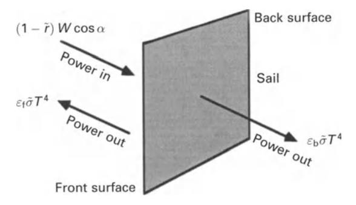
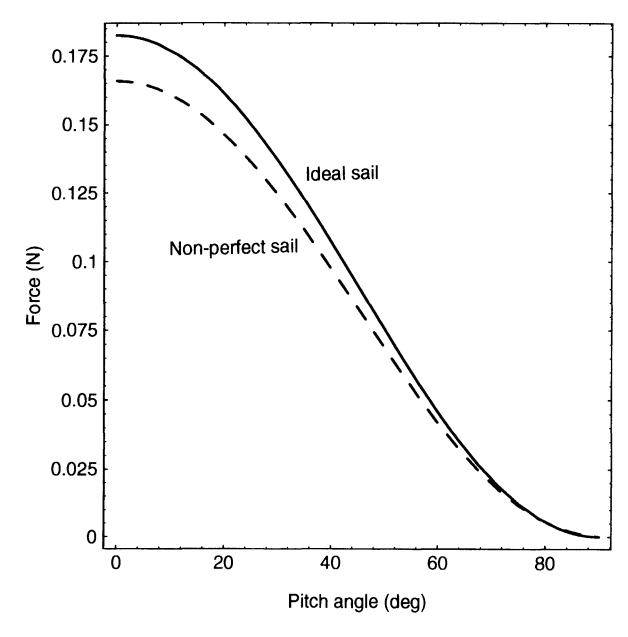

found to hold between these unit vectors:

$$\mathbf{u} = \cos \alpha \,\mathbf{n} + \sin \alpha \,\mathbf{t} \tag{2.49a}$$

$$\mathbf{s} = -\cos\alpha\,\mathbf{n} + \sin\alpha\,\mathbf{t} \tag{2.49b}$$

where a is again the pitch angle of the solar sail relative to the Sun-line. **In** addition, by combining Eqs (2.49a) and (2.49b) it can be seen that

$$\mathbf{s} = \mathbf{u} - 2\cos\alpha\,\mathbf{n} \tag{2.49c}$$

Initially it will be assumed that all incident photons are absorbed by the sail. Then the fraction of these incident photons which are re-emitted by reflection and reradiation will be considered.

The force exerted on the solar sail due to absorbed photons is given by *P A* cos a u, where *A* cos a is the projected sail area in direction u. Resolving this force into normal and transverse components using Eq. (2.49a), it is found that

$$f_{\mathbf{a}} = PA(\cos^2 \alpha \,\mathbf{n} + \cos \alpha \sin \alpha \,\mathbf{t}) \tag{2.50}$$

A fraction *r* of the incident photons will now be reflected. Of that fraction of photons another fraction s will be specularly reflected in direction s, so providing a force *Irs* in -s direction given by *Irs* = *-(rs)PA* cosns (2.51 )

$$\mathbf{f}_{rs} = -(\tilde{r}s)PA\cos\alpha\mathbf{s} \tag{2.51}$$

**In** addition, another fraction of photons will be uniformly scattered from the reflecting surface of the sail due to non-specular reflection. This component will generate a force *fru* in direction n given by

$$f_{ru} = B_f \tilde{r} (1 - s) PA \cos \alpha \,\mathbf{n} \tag{2.52}$$

where the coefficient *Bf* indicates that the front surface of the sail will be non-Lambertian. A Lambertian surface is one which appears equally bright when viewed from any aspect angle. The non-Lambertian coefficient then describes the deviation from this condition. The total force due to reflected photons is now given by *f·,* + *frll"*  Using Eq. (2.49b) to again write the total force in terms of the normal and transverse directions yields

$$f_r = PA[(\tilde{r}s\cos^2\alpha + B_f(1-s)\tilde{r}\cos\alpha)\mathbf{n} - \tilde{r}s\cos\alpha\sin\alpha\mathbf{t}]$$
 (2.53)

The final force component is that due to photons which have been absorbed and then re-emitted as thermal radiation from both the front and back surfaces of the sail. The power emitted from a unit area of the sail at temperature *Tis ciTT4 ,* where *(j* is the Stefan-Boltzmann constant and C is the surface emissivity. Again, the tilde notation *(j* is used to avoid confusion with the sail loading *(J.* Therefore, allowing for the non-Lambertian nature of the front and back sail surfaces, and assuming the sail has uniform temperature, the force due to emission by re-radiation is given by

$$f_{\rm c} = \frac{\tilde{\sigma}T^4}{c} (\varepsilon_{\rm f}B_{\rm f} - \varepsilon_{\rm b}B_{\rm b})\mathbf{n} \tag{2.54}$$

where Cf and Cb are the front and back emissivities. The sail temperature may now be

Fig. 2.8. Solar sail thermal balance.

obtained from the balance between the thermal input and the thermal output of  $(\varepsilon_{\rm f} + \varepsilon_{\rm b})\tilde{\sigma}T^4$ , as shown in Fig. 2.8. The thermal input to the sail is given by  $(1-\tilde{r})W\cos\alpha$ , where W is the solar flux incident on the sail. However, since the radiation pressure is just W/c the sail temperature may be written as

$$T = \left[ \frac{(1 - \tilde{r})cP\cos\alpha}{\tilde{\sigma}(\varepsilon_{\rm f} + \varepsilon_{\rm b})} \right]^{1/4} \tag{2.55}$$

Therefore, substituting for the sail equilibrium temperature, the force exerted on the solar sail due to emission by re-radiation is given by

$$f_{e} = PA(1 - \tilde{r}) \frac{\varepsilon_{f} B_{f} - \varepsilon_{b} B_{b}}{\varepsilon_{f} + \varepsilon_{b}} \cos \alpha \,\mathbf{n}$$
 (2.56)

It is clear from Eq. (2.56) that a sail backing of low emissivity is required to maximise the normal force. However, the emissivity of the backing is the only coefficient which can be used to control the sail temperature.

Collecting all of these contributions, the total force exerted on the solar sail may be written in terms of normal and transverse components as

$$f_{n} = PA \left\{ (1 + \tilde{r}s)\cos^{2}\alpha + B_{f}(1 - s)\tilde{r}\cos\alpha + (1 - \tilde{r})\frac{\varepsilon_{f}B_{f} - \varepsilon_{b}B_{b}}{\varepsilon_{f} + \varepsilon_{b}}\cos\alpha \right\} \mathbf{n} \quad (2.57a)$$

$$f_{t} = PA(1 - \tilde{r}s)\cos\alpha\sin\alpha t \qquad (2.57b)$$

The total force vector and force magnitude may then be written as

$$\mathbf{f} = f\mathbf{m} \tag{2.58a}$$

$$f = (f_{\rm n}^2 + f_{\rm t}^2)^{1/2} \tag{2.58b}$$

where **m** is the unit vector in the direction of the total force, as shown in Fig. 2.7. The angle of the force vector relative to the incident radiation will be defined by the cone angle  $\theta$ . Since a real sail is not a perfect reflector, the direction of the force vector will not be normal to the sail surface as the force due to absorbed photons is somewhat greater than that due to reflected photons. Therefore, the force vector direction is

Fig. 2.9. Force exerted on a 100 x 100m ideal square solar sail and non-perfect square solar sail at I au.

**Table 2.1.** Optical coefficients for an ideal solar sail, JPL square sail and JPL heliogyro.

|             |      | s    |      |      | Br   |      |
|-------------|------|------|------|------|------|------|
| Ideal sail  |      |      | o    | o    | 2/3  | 2/3  |
| Square sail | 0.88 | 0.94 | 0.05 | 0.55 | 0.79 | 0.55 |
| Heliogyro   | 0.88 | 0.94 | 0.05 | 0.55 | 0.79 | 0.55 |

biased towards the direction of incident radiation. The angle between the force vector and the sail normal is the centre-line angle ¢ given by

$$\tan \phi = \frac{f_{\rm t}}{f_{\rm n}} \tag{2.59}$$

again shown in Fig. 2.7. As will be seen, the centre-line angle constrains the direction of the force vector cone angle. For a perfectly reflecting solar sail, of course, the centre-line angle vanishes since the force vector is always directed normal to the sail surface.

Sail optical parameters derived from the JPL comet Halley rendezvous study are listed in Table 2.1 for a square sail and heliogyro. These parameters will now be used to compare the optical solar sail model to an idea solar sail, as shown in Fig. 2.9, where the total force exerted on a 100 x 100 m square solar sail located at 1 au has been calculated. It can be seen that there is a significant difference in force magnitude